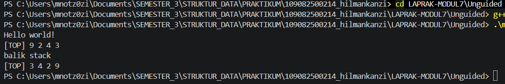
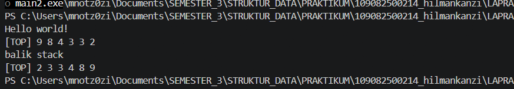
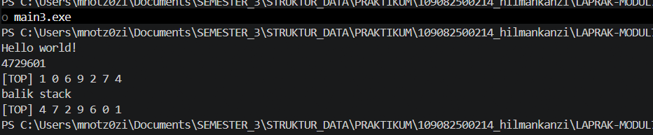

# <h1 align="center">Laporan Praktikum Modul 7 - STACK</h1>
<p align="center">Hilman kanzi - 109082500214</p>

## Dasar Teori
Stack merupakan salah satu struktur data linear yang menggunakan prinsip LIFO (Last In First Out), yaitu elemen yang terakhir dimasukkan akan menjadi elemen pertama yang dikeluarkan. Stack memiliki bentuk seperti tumpukan, sehingga proses penambahan dan pengambilan data hanya dilakukan melalui satu bagian yang disebut Top [1].

Stack dapat diimplementasikan menggunakan dua representasi, yaitu pointer dan array. Pada representasi pointer, setiap elemen dihubungkan menggunakan pointer yang menunjuk ke elemen berikutnya. Sedangkan pada representasi array, elemen disimpan dalam indeks tertentu dengan kapasitas yang telah ditentukan [1].

### A. Komponen dan Konsep Dasar Stack<br/>
...
#### 1. Top
Top merupakan penanda posisi elemen paling atas dalam Stack. Top digunakan untuk mengetahui posisi elemen terakhir yang dimasukkan dan menjadi acuan dalam proses penambahan maupun pengambilan data.
#### 2. LIFO (Last In First Out)
LIFO merupakan prinsip utama dalam Stack, yaitu data yang terakhir dimasukkan akan menjadi data pertama yang dikeluarkan. Contohnya, apabila data 3, 4, dan 8 dimasukkan secara berurutan, maka data yang pertama kali diambil adalah 8.
#### 3. Representasi Stack
Stack dapat dibuat menggunakan pointer maupun array. Pada implementasi array, data disimpan dalam sebuah array dengan indeks yang menunjukkan posisi elemen. Pada implementasi pointer, setiap elemen memiliki hubungan dengan elemen lainnya melalui alamat memori.

### B. Operasi dan Fungsi pada Stack<br/>
...
#### 1. Push
Push merupakan operasi untuk menambahkan elemen baru ke dalam Stack. Data yang dimasukkan akan ditempatkan pada posisi paling atas sehingga nilai Top mengalami perubahan.
#### 2. Pop
Pop merupakan operasi untuk mengambil atau menghapus elemen paling atas dari Stack. Setelah elemen diambil, posisi Top akan berpindah ke elemen sebelumnya.
#### 3. Operasi Tambahan
Selain Push dan Pop, terdapat beberapa operasi tambahan seperti CreateStack untuk membuat Stack kosong, isEmpty untuk memeriksa kondisi Stack, printInfo untuk menampilkan isi Stack, dan balikStack untuk membalik urutan elemen Stack.

## Guided 

### 1. Stack.h

```C++
/* file : stack.h
   contoh ADT stack dengan representasi tabel */
#ifndef STACK_H_INCLUDED
#define STACK_H_INCLUDED

#include <iostream>
using namespace std;

struct infotype {
    char nim[20];
    char nama[20];
};
struct Stack {
    infotype info[10];
    int Top;
};

/* prototype */
/******** pengecekan apakah Stack kosong *********/
int isEmpty(Stack S);
/* mengembalikan nilai 0 jika stack kosong */

/******** pembuatan Stack ********/
void createStack(Stack &S);
/* I.S. sembarang
   F.S. terbentuk stack dengan Top=0 */

/******** penambahan elemen pada Stack ********/
void push(Stack &S, infotype X);
/* I.S. Stack mungkin kosong
   F.S. menambahkan elemen pada stack dengan nilai X, TOP=TOP+1 */

/******** penghapusan elemen pada Stack ********/
void pop(Stack &S, infotype &X);
/* I.S. stack tidak kosong
   F.S. nilai info pada indeks TOP disimpan pada X, kemudian TOP=TOP-1 */

/******** proses semua elemen Stack *********/
void viewStack(Stack S);
/* I.S. stack mungkin kosong
   F.S. jika stack tidak kosong menampilkan semua info yang ada pada stack
*/
#endif // STACK_H_INCLUDED

```
### Penjelasan singkat 
Pada program stack.h, dibuat deklarasi struktur data Stack menggunakan representasi array. Program menggunakan struktur infotype yang memiliki atribut nim dan nama untuk menyimpan identitas mahasiswa. Selanjutnya, struktur Stack memiliki array info[10] untuk menampung maksimal 10 data mahasiswa dan variabel Top untuk menunjukkan posisi elemen paling atas.

Selain itu, terdapat beberapa deklarasi fungsi, yaitu isEmpty(), createStack(), push(), pop(), dan viewStack(). Deklarasi tersebut digunakan sebagai penghubung antara file header dengan implementasi fungsi yang terdapat pada stack.cpp.

### 2. Stack.cpp

```C++
#include "stack.h"

int isEmpty(Stack S) {
    /* Top = 0 berarti kosong, sesuai komentar di stack.h dikembalikan 0 */
    if (S.Top == 0) {
        return 0;
    } else {
        return 1;
    }
}

void createStack(Stack &S) {
    S.Top = 0;
}

void push(Stack &S, infotype X) {
    if (S.Top < 10) {
        S.Top = S.Top + 1;
        S.info[S.Top - 1] = X;   /* Top 1..10 dipetakan ke indeks array 0..9 */
    } else {
        cout << "Stack penuh, data tidak bisa ditambahkan" << endl;
    }
}

void pop(Stack &S, infotype &X) {
    if (isEmpty(S) != 0) {
        X = S.info[S.Top - 1];
        S.Top = S.Top - 1;
    } else {
        cout << "Stack kosong, tidak ada data yang bisa diambil" << endl;
    }
}

void viewStack(Stack S) {
    if (isEmpty(S) == 0) {
        cout << "Stack kosong" << endl;
    } else {
        cout << "Isi stack (dari TOP):" << endl;
        for (int i = S.Top; i >= 1; i--) {
            cout << i << ". " << S.info[i - 1].nim << " - "
                 << S.info[i - 1].nama << endl;
        }
    }
}

```
### Penjelasan singkat 
Pada program stack.cpp, dilakukan implementasi dari fungsi-fungsi yang telah dideklarasikan pada stack.h.

isEmpty() digunakan untuk memeriksa apakah Stack dalam keadaan kosong. Fungsi mengembalikan nilai 0 apabila Stack kosong dan 1 apabila terdapat data.

createStack() digunakan untuk membuat Stack baru dengan mengatur nilai Top menjadi 0.

push() digunakan untuk memasukkan data mahasiswa ke dalam Stack. Sebelum memasukkan data, program memeriksa apakah kapasitas Stack masih tersedia.

pop() digunakan untuk mengambil data paling atas. Data tersebut disimpan terlebih dahulu ke variabel hasil, kemudian posisi Top dikurangi satu.

viewStack() digunakan untuk menampilkan seluruh data yang tersimpan dalam Stack, dimulai dari elemen paling atas.

Dengan implementasi tersebut, seluruh proses pengelolaan data Stack dapat dilakukan melalui fungsi-fungsi yang telah dibuat.

### 3. main.cpp

```C++
#include <iostream>
#include <cstring>
#include "stack.h"
using namespace std;

int main() {
    Stack S;
    infotype data, hasil;

    createStack(S);
    cout << "Stack baru dibuat, Top = " << S.Top << endl;
    viewStack(S);

    cout << endl << "--- Push 3 data ---" << endl;
    strcpy(data.nim, "103112400001");
    strcpy(data.nama, "Andi");
    push(S, data);

    strcpy(data.nim, "103112400002");
    strcpy(data.nama, "Budi");
    push(S, data);

    strcpy(data.nim, "103112400003");
    strcpy(data.nama, "Citra");
    push(S, data);
    viewStack(S);

    cout << endl << "--- Pop 1 data ---" << endl;
    pop(S, hasil);
    cout << "Data yang diambil: " << hasil.nim << " - " << hasil.nama << endl;
    viewStack(S);

    cout << endl << "--- Pop sampai kosong ---" << endl;
    pop(S, hasil);
    pop(S, hasil);
    pop(S, hasil);
    viewStack(S);

    return 0;
}

```
### Penjelasan singkat 
Pada program main.cpp, dilakukan pengujian terhadap fungsi-fungsi Stack yang telah dibuat sebelumnya. Pertama, program membuat Stack kosong menggunakan createStack() dan menampilkan kondisinya menggunakan viewStack().
Selanjutnya, program memasukkan tiga data mahasiswa, yaitu Andi, Budi, dan Citra menggunakan operasi push(). Setelah semua data dimasukkan, program menampilkan isi Stack untuk melihat urutan data yang tersimpan.
Kemudian, dilakukan operasi pop() untuk mengambil satu data paling atas dan menampilkan data yang berhasil diambil. Setelah itu, program melakukan beberapa operasi pop kembali hingga Stack menjadi kosong.
Program ini bertujuan untuk mengetahui cara kerja operasi Push dan Pop serta memastikan bahwa data yang terakhir dimasukkan akan menjadi data pertama yang dikeluarkan sesuai prinsip LIFO.

## Unguided 

### 1. (Buatlah ADT Stack menggunakan ARRAY sebagai berikut di dalam file “stack.h”: Buatlah implementasi ADT Stack menggunakan Array pada file “stack.cpp” dan “main.cpp”)

### Stack.h
```C++
#ifndef STACK_H
#define STACK_H

#include <iostream>
using namespace std;

typedef int infotype;

struct Stack {
    infotype info[20];
    int top;            
};

void CreateStack(Stack &S);
void push(Stack &S, infotype x);
infotype pop(Stack &S);
void printInfo(Stack S);
void balikStack(Stack &S);


void pushAscending(Stack &S, infotype x);


void getInputStream(Stack &S);

#endif

```
### Stack.cpp

```C++
#include "stack.h"

void CreateStack(Stack &S) {
    S.top = -1;
}

void push(Stack &S, infotype x) {
    if (S.top < 19) {
        S.top++;
        S.info[S.top] = x;
    } else {
        cout << "Stack penuh!" << endl;
    }
}

infotype pop(Stack &S) {
    if (S.top == -1) {
        cout << "Stack kosong!" << endl;
        return -1;
    }
    infotype x = S.info[S.top];
    S.top--;
    return x;
}

void printInfo(Stack S) {
    cout << "[TOP] ";
    for (int i = S.top; i >= 0; i--) {
        cout << S.info[i] << " ";
    }
    cout << endl;
}

void balikStack(Stack &S) {
    int i = 0, j = S.top;
    while (i < j) {
        infotype temp = S.info[i];
        S.info[i] = S.info[j];
        S.info[j] = temp;
        i++;
        j--;
    }
}

void pushAscending(Stack &S, infotype x) {
    Stack temp;
    CreateStack(temp);

    while (S.top != -1 && S.info[S.top] > x) {
        push(temp, pop(S));
    }
    push(S, x);
    while (temp.top != -1) {
        push(S, pop(temp));
    }
}

void getInputStream(Stack &S) {
    char c = cin.get();
    while (c != '\n') {
        if (c >= '0' && c <= '9') {
            push(S, c - '0');
        }
        c = cin.get();
    }
}

```
### main1.cpp

```C++
#include "stack.h"

int main() {
    cout << "Hello world!" << endl;
    Stack S;
    CreateStack(S);
    push(S, 3);
    push(S, 4);
    push(S, 8);
    pop(S);
    push(S, 2);
    push(S, 1);
    pop(S);
    push(S, 9);
    printInfo(S);
    cout << "balik stack" << endl;
    balikStack(S);
    printInfo(S);
    return 0;
}

```
### Penjelasan
Pada program main1.cpp, dilakukan pengujian implementasi ADT Stack menggunakan array dengan tipe data integer. Pertama, program membuat Stack menggunakan fungsi CreateStack() sehingga kondisi awal Stack menjadi kosong.

Selanjutnya, program memasukkan beberapa angka menggunakan operasi push(), yaitu 3, 4, dan 8. Setelah itu, dilakukan operasi pop() untuk mengambil elemen paling atas. Program kemudian memasukkan kembali angka 2 dan 1, melakukan operasi pop sekali lagi, dan menambahkan angka 9.

Setelah seluruh operasi selesai, fungsi printInfo() digunakan untuk menampilkan isi Stack. Selanjutnya, program menjalankan fungsi balikStack() untuk membalik urutan elemen yang tersimpan di dalam array. Hasilnya ditampilkan kembali menggunakan printInfo().

Dari program ini dapat diketahui bahwa operasi Push dan Pop mengikuti prinsip LIFO, sedangkan fungsi balikStack digunakan untuk membalik urutan elemen Stack.

#### 2. (Tambahkan prosedur pushAscending( in/out S : Stack, in x : integer))
## main2.cpp
```C++
#include "stack.h"

int main() {
    cout << "Hello world!" << endl;
    Stack S;
    CreateStack(S);
    pushAscending(S, 3);
    pushAscending(S, 4);
    pushAscending(S, 8);
    pushAscending(S, 2);
    pushAscending(S, 3);
    pushAscending(S, 9);
    printInfo(S);
    cout << "balik stack" << endl;
    balikStack(S);
    printInfo(S);
    return 0;
}

```
### Penjelasan
Pada program main2.cpp, dilakukan penambahan prosedur pushAscending() untuk memasukkan data ke dalam Stack berdasarkan urutan nilai secara ascending atau menaik.

Program diawali dengan membuat Stack kosong menggunakan CreateStack(). Selanjutnya, beberapa angka dimasukkan menggunakan prosedur pushAscending(), yaitu 3, 4, 8, 2, 3, dan 9.

Pada prosedur pushAscending(), digunakan Stack sementara untuk membantu mengatur posisi data. Apabila nilai pada bagian atas Stack lebih besar daripada nilai yang akan dimasukkan, elemen tersebut dipindahkan terlebih dahulu ke Stack sementara menggunakan operasi Pop. Setelah posisi yang sesuai ditemukan, nilai baru dimasukkan menggunakan Push. Kemudian, elemen yang sebelumnya dipindahkan dikembalikan ke Stack utama.

Setelah semua data dimasukkan, program menampilkan isi Stack menggunakan printInfo(). Selanjutnya, fungsi balikStack() dijalankan untuk membalik urutan elemen dan menampilkan hasilnya kembali.

Berdasarkan hasil program, angka yang dimasukkan tersusun secara ascending dari bagian bawah ke bagian atas Stack. Ketika ditampilkan dari posisi TOP, urutannya terlihat menurun, yaitu 9, 8, 4, 3, 3, dan 2.

#### 3. (Tambahkan prosedur getInputStream( in/out S : Stack ). Prosedur akan terus membaca dan menerima input user dan memasukkan setiap input ke dalam stack hingga user menekan tombol enter. Contoh: gunakan cin.get() untuk mendapatkan inputan user.)
### main3.cpp
```C++
#include "stack.h"

int main() {
    cout << "Hello world!" << endl;
    Stack S;
    CreateStack(S);
    getInputStream(S);
    printInfo(S);
    cout << "balik stack" << endl;
    balikStack(S);
    printInfo(S);
    return 0;
}
```
### Penjelasan
Pada program main3.cpp, ditambahkan prosedur getInputStream() yang digunakan untuk menerima masukan angka secara langsung dari pengguna melalui keyboard.

Pertama, program membuat Stack kosong menggunakan fungsi CreateStack(). Selanjutnya, prosedur getInputStream() dijalankan untuk membaca setiap karakter yang dimasukkan oleh pengguna menggunakan cin.get().

Setiap karakter yang dibaca akan diperiksa. Apabila karakter tersebut merupakan angka dari 0 sampai 9, maka karakter akan dikonversi menjadi tipe integer menggunakan operasi c - '0' dan dimasukkan ke dalam Stack menggunakan fungsi push().

Proses pembacaan akan terus berlangsung hingga pengguna menekan tombol Enter. Setelah proses input selesai, fungsi printInfo() digunakan untuk menampilkan seluruh angka yang telah dimasukkan. Kemudian, program menjalankan fungsi balikStack() untuk membalik urutan elemen dan menampilkan hasil akhirnya.

Melalui program ini, pengguna dapat memasukkan data sendiri tanpa harus menentukan angka secara langsung di dalam kode program. Program juga menunjukkan penerapan operasi Stack terhadap data yang diperoleh dari input pengguna.

### Output :

##### Output main 1

##### Output main 2 

##### Output main 3


## Kesimpulan
Berdasarkan praktikum Modul 7 tentang Stack yang telah dilakukan, dapat disimpulkan bahwa Stack merupakan struktur data linear yang menggunakan prinsip LIFO (Last In First Out), yaitu data yang terakhir dimasukkan akan menjadi data pertama yang dikeluarkan.

Pada praktikum ini, Stack berhasil diimplementasikan menggunakan array dengan beberapa operasi utama, seperti CreateStack, Push, Pop, dan printInfo. Selain itu, dilakukan pengembangan fungsi tambahan berupa balikStack() untuk membalik urutan elemen, pushAscending() untuk memasukkan data berdasarkan urutan menaik, serta getInputStream() untuk menerima input angka secara langsung dari pengguna.

Melalui ketiga program Unguided, dapat dipahami bahwa pengelolaan data pada Stack bergantung pada posisi Top dan urutan operasi yang dilakukan. Penggunaan Stack sementara pada pushAscending() juga menunjukkan bahwa struktur data tambahan dapat membantu mengatur urutan elemen.

Dengan demikian, praktikum ini memberikan pemahaman mengenai konsep dasar Stack, penerapan operasi-operasinya menggunakan array, serta pengembangan fungsi tambahan dalam bahasa pemrograman C++.
...

## Referensi
[1] Cormen, T. H., Leiserson, C. E., Rivest, R. L., & Stein, C. (2009). Introduction to Algorithms (3rd ed.). MIT Press. Bab 10 membahas struktur data dasar, termasuk Stack dan Queue.
[2] Weiss, M. A. (2014). Data Structures and Algorithm Analysis in C++ (4th ed.). Pearson.
[3] OpenDSA. (n.d.). Data Structures and Algorithms. Virginia Tech. Materi pembelajaran mengenai struktur data dan algoritma. https://opendsa-server.cs.vt.edu/
[4] Aspnes, J. (2022). Notes on Data Structures and Programming Techniques. Yale University. Bagian 5.4 membahas implementasi Stack menggunakan array dan linked list. https://www.cs.yale.edu/homes/aspnes/classes/223/notes.html