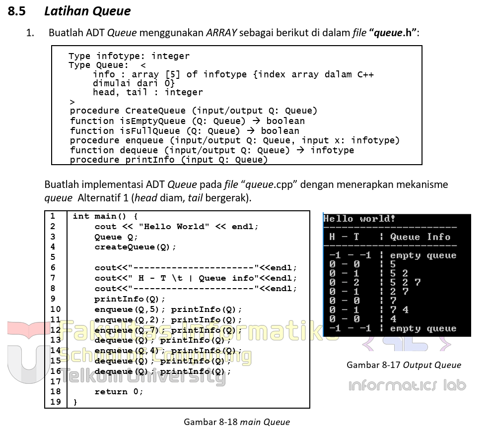
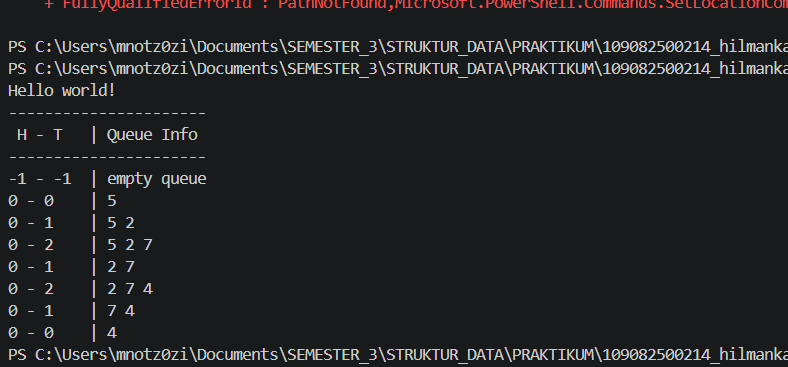
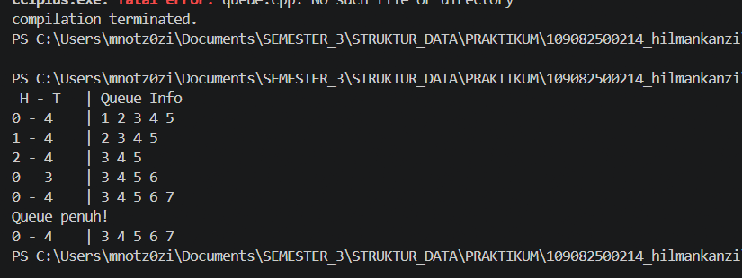
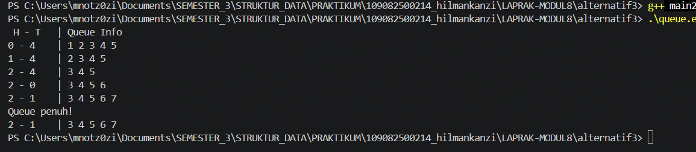

# <h1 align="center">Laporan Praktikum Modul 8 - QUEUE </h1>
<p align="center">Hilman kanzi - 109082500214</p>

## Dasar Teori
Queue merupakan salah satu struktur data linear yang digunakan untuk menyimpan dan mengelola sekumpulan data dengan prinsip FIFO (First In First Out), yaitu data yang pertama kali dimasukkan akan menjadi data pertama yang dikeluarkan. Queue memiliki cara kerja seperti antrean pada loket, di mana orang yang datang lebih dahulu akan mendapatkan pelayanan lebih dahulu. Struktur data Queue memiliki dua operasi utama, yaitu Enqueue untuk menambahkan data dan Dequeue untuk menghapus atau mengambil data [1].

### A. Konsep Dasar Queue<br/>
Queue memiliki beberapa komponen dan karakteristik yang digunakan dalam proses pengelolaan data.
#### 1. FIFO (First In First Out)
FIFO merupakan prinsip utama dalam struktur data Queue. Prinsip ini menjelaskan bahwa elemen yang pertama kali masuk akan menjadi elemen pertama yang keluar. Dengan demikian, urutan data yang dimasukkan tetap dipertahankan ketika proses penghapusan dilakukan [2].
#### 2. Head dan Tail
Head merupakan penanda posisi elemen paling depan dalam Queue, yaitu elemen yang akan dikeluarkan terlebih dahulu. Sedangkan Tail merupakan penanda posisi elemen paling belakang, yaitu tempat data baru ditambahkan. Kedua penanda tersebut digunakan untuk mengatur proses penambahan dan penghapusan data [3].
#### 3.  Representasi Queue
Queue dapat diimplementasikan menggunakan dua jenis representasi, yaitu Array dan Linked List. Representasi Array menyimpan elemen dalam kumpulan indeks dengan kapasitas tertentu, sedangkan Linked List menyimpan elemen dalam bentuk node yang saling terhubung menggunakan pointer. Linked List memungkinkan penambahan dan penghapusan elemen secara dinamis melalui pengaturan alamat setiap node [4].

### B. Operasi dan Implementasi Queue<br/>
Dalam penerapannya, Queue memiliki beberapa operasi dasar yang digunakan untuk mengelola data.
#### 1. Enqueue
Enqueue merupakan operasi untuk menambahkan elemen baru ke dalam Queue. Proses penambahan dilakukan pada bagian belakang atau Tail. Apabila Queue masih kosong, maka Head dan Tail akan menunjuk pada elemen pertama yang dimasukkan.
#### 2. Dequeue
Dequeue merupakan operasi untuk mengambil atau menghapus elemen paling depan dari Queue. Setelah elemen dihapus, posisi Head akan berpindah ke elemen berikutnya. Apabila elemen yang tersisa hanya satu, maka Head dan Tail akan dikembalikan ke kondisi kosong.
#### 3. Implementasi Queue Menggunakan Array dan Linked List
Implementasi Queue menggunakan Array memiliki kapasitas penyimpanan yang telah ditentukan sehingga pengelolaan indeks Head dan Tail perlu diperhatikan. Pada implementasi Linked List, setiap elemen disimpan dalam node yang memiliki data dan pointer menuju node berikutnya. Penggunaan pointer Head dan Tail memungkinkan proses Enqueue dilakukan pada bagian belakang dan Dequeue pada bagian depan tanpa harus menggeser seluruh elemen.

Dalam implementasi Array, terdapat tiga alternatif pengelolaan Queue. Alternatif 1 menggunakan Head tetap dan Tail bergerak, sehingga elemen perlu digeser ketika terjadi penghapusan. Alternatif 2 menggunakan Head dan Tail yang sama-sama bergerak, tetapi dapat mengalami kondisi penuh semu ketika Tail mencapai batas akhir array. Alternatif 3 menggunakan konsep Circular Queue, yaitu indeks Head dan Tail bergerak secara melingkar sehingga ruang kosong pada bagian awal array dapat digunakan kembali [5].

## Guided 

### 1. queue.h

```C++

#ifndef QUEUE_H_INCLUDE
#define QUEUE_H_INCLUDE

#include <iostream>

#define Nil NULL

typedef int infotype;
typedef bool boolean;
typedef struct elmQ *address;

struct elmQ {
    infotype info;
    address next;
};

struct queue {
    address head;
    address tail;
};

typedef struct queue queue;

boolean isEmpty(queue Q);
void CreateQueue(queue &Q);

address alokasi(infotype X);
void dealokasi(address P);

address findElm(queue Q, infotype X);
boolean fFindElm(queue Q, address P);

void insert(queue &Q, address P);
void deleteQueue(queue &Q, address &P);

void printInfo(queue Q);
int nbList(queue Q);
void delAll(queue &Q);

#endif

```
### penjelasan
Pada file queue.h, dibuat deklarasi ADT Queue menggunakan representasi Linked List. Program diawali dengan penggunaan #ifndef dan #define sebagai pelindung agar file header tidak diproses berulang kali ketika dipanggil oleh file lain.

Selanjutnya, terdapat deklarasi infotype menggunakan tipe data integer dan boolean menggunakan tipe data bool. Struktur elmQ digunakan untuk membentuk node yang memiliki dua bagian, yaitu info untuk menyimpan nilai data dan next sebagai pointer yang menunjuk ke node berikutnya.

Kemudian, dibuat struktur queue yang memiliki dua pointer utama, yaitu head dan tail. Head digunakan untuk menunjuk elemen pertama, sedangkan Tail menunjuk elemen terakhir dalam Queue.

Pada bagian akhir terdapat prototype fungsi yang akan digunakan dalam program, seperti isEmpty(), CreateQueue(), alokasi(), dealokasi(), findElm(), fFindElm(), insert(), deleteQueue(), printInfo(), nbList(), dan delAll().

File header ini berfungsi sebagai tempat deklarasi struktur data dan fungsi agar dapat digunakan serta diimplementasikan pada file queue.cpp dan main.cpp.

### 2. queue.cpp

```C++

#include "queue.h"
#include <iostream>
#include <new>

using namespace std;

boolean isEmpty(queue Q) {
    return (Q.head == Nil);
}

void CreateQueue(queue &Q) {
    Q.head = Nil;
    Q.tail = Nil;
}

address alokasi(infotype X) {
    address P = new (nothrow) elmQ;

    if (P != Nil) {
        P->info = X;
        P->next = Nil;
    }

    return P;
}

void dealokasi(address P) {
    delete P;
}

address findElm(queue Q, infotype X) {
    address P = Q.head;

    while (P != Nil) {
        if (P->info == X) {
            return P;
        }

        P = P->next;
    }

    return Nil;
}

boolean fFindElm(queue Q, address P) {
    address R = Q.head;

    while (R != Nil) {
        if (R == P) {
            return true;
        }

        R = R->next;
    }

    return false;
}

void insert(queue &Q, address P) {
    if (P == Nil) {
        return;
    }

    if (isEmpty(Q)) {
        Q.head = P;
        Q.tail = P;
    } else {
        Q.tail->next = P;
        Q.tail = P;
    }
}

void deleteQueue(queue &Q, address &P) {
    if (isEmpty(Q)) {
        P = Nil;
        return;
    }

    P = Q.head;

    if (Q.head == Q.tail) {
        Q.head = Nil;
        Q.tail = Nil;
    } else {
        Q.head = Q.head->next;
    }

    P->next = Nil;
}

void printInfo(queue Q) {
    if (isEmpty(Q)) {
        cout << "Queue kosong" << endl;
    } else {
        address P = Q.head;

        while (P != Nil) {
            cout << P->info << " ";
            P = P->next;
        }

        cout << endl;
    }
}

int nbList(queue Q) {
    int jumlah = 0;
    address P = Q.head;

    while (P != Nil) {
        jumlah++;
        P = P->next;
    }

    return jumlah;
}

void delAll(queue &Q) {
    address P;

    while (!isEmpty(Q)) {
        deleteQueue(Q, P);
        dealokasi(P);
    }
}
```
### penjelasan
Pada file queue.cpp, dilakukan implementasi seluruh fungsi yang telah dideklarasikan dalam queue.h. File ini berisi proses utama untuk mengelola data Queue menggunakan Linked List.

Berikut penjelasan fungsi-fungsi yang digunakan:

isEmpty() digunakan untuk memeriksa apakah Queue dalam keadaan kosong dengan mengecek apakah nilai Head sama dengan Nil atau NULL.

CreateQueue() digunakan untuk membuat Queue baru dalam kondisi kosong dengan mengatur pointer Head dan Tail menjadi Nil.

alokasi() digunakan untuk membuat node baru menggunakan new (nothrow). Jika alokasi berhasil, nilai data dimasukkan ke bagian info dan pointer next diatur menjadi Nil.

dealokasi() digunakan untuk mengembalikan memori node yang sudah tidak digunakan menggunakan perintah delete.

findElm() digunakan untuk mencari elemen berdasarkan nilai data yang dimasukkan. Proses pencarian dilakukan dengan menelusuri node mulai dari Head sampai data ditemukan atau mencapai akhir Queue.

fFindElm() digunakan untuk memeriksa apakah alamat suatu node terdapat di dalam Queue. Pemeriksaan dilakukan dengan membandingkan alamat pointer setiap node dengan alamat yang dicari.

insert() digunakan untuk menambahkan node baru pada bagian belakang Queue. Jika Queue masih kosong, Head dan Tail akan menunjuk pada node yang sama. Jika sudah terdapat elemen, node baru dihubungkan melalui Q.tail->next, kemudian Tail diperbarui.

deleteQueue() digunakan untuk menghapus elemen paling depan. Node yang dihapus disimpan pada pointer P, kemudian Head dipindahkan ke node berikutnya. Jika hanya terdapat satu elemen, Head dan Tail dikembalikan menjadi Nil.

printInfo() digunakan untuk menampilkan seluruh data yang tersimpan dalam Queue dengan menelusuri node mulai dari Head sampai mencapai Nil.

nbList() digunakan untuk menghitung jumlah elemen yang terdapat dalam Queue dengan melakukan penelusuran setiap node dan menambahkan nilai penghitung.

delAll() digunakan untuk menghapus seluruh elemen Queue. Proses dilakukan dengan memanggil deleteQueue() dan dealokasi() secara berulang sampai Queue menjadi kosong.

Dengan adanya fungsi-fungsi tersebut, pengelolaan Queue dapat dilakukan secara terstruktur, mulai dari pembuatan, penambahan, pencarian, penghapusan, hingga penghitungan jumlah elemen.

### 3. main.cpp

```C++

#include "queue.h"
#include <iostream>

using namespace std;

int main() {
    queue Q;
    address P;

    CreateQueue(Q);

    cout << "===== PROGRAM ADT QUEUE =====" << endl;

    cout << "\n1. Membuat Queue Kosong" << endl;
    if (isEmpty(Q)) {
        cout << "Queue berhasil dibuat dan masih kosong." << endl;
    }

    cout << "\n2. Menambahkan Elemen Queue" << endl;

    P = alokasi(10);
    insert(Q, P);

    P = alokasi(20);
    insert(Q, P);

    P = alokasi(30);
    insert(Q, P);

    cout << "Isi Queue: ";
    printInfo(Q);

    cout << "Jumlah Elemen: " << nbList(Q) << endl;

    cout << "\n3. Mencari Elemen Queue" << endl;

    P = findElm(Q, 20);

    if (P != Nil) {
        cout << "Elemen 20 ditemukan." << endl;
    } else {
        cout << "Elemen 20 tidak ditemukan." << endl;
    }

    cout << "\n4. Mengecek Address Elemen" << endl;

    if (fFindElm(Q, P)) {
        cout << "Address elemen terdapat dalam Queue." << endl;
    } else {
        cout << "Address elemen tidak terdapat dalam Queue." << endl;
    }

    cout << "\n5. Menghapus Elemen Pertama" << endl;

    deleteQueue(Q, P);

    if (P != Nil) {
        cout << "Elemen yang dihapus: " << P->info << endl;
        dealokasi(P);
    }

    cout << "Isi Queue sekarang: ";
    printInfo(Q);

    cout << "Jumlah Elemen: " << nbList(Q) << endl;

    cout << "\n6. Menghapus Semua Elemen Queue" << endl;

    delAll(Q);

    if (isEmpty(Q)) {
        cout << "Semua elemen berhasil dihapus." << endl;
    }

    cout << "Jumlah Elemen: " << nbList(Q) << endl;

    cout << "\n===== PROGRAM SELESAI =====" << endl;

    return 0;
}
```
### penjelasan
Pada file main.cpp, dilakukan pengujian terhadap fungsi-fungsi ADT Queue yang telah dibuat pada file queue.cpp.

Pertama, program membuat variabel Queue Q dan pointer P, kemudian memanggil CreateQueue(Q) untuk menginisialisasi Queue dalam keadaan kosong.

Selanjutnya, program menguji fungsi isEmpty() untuk memastikan bahwa Queue berhasil dibuat dan belum memiliki elemen.

Pada tahap berikutnya, program melakukan penambahan tiga elemen, yaitu 10, 20, dan 30 menggunakan fungsi alokasi() dan insert(). Setelah itu, fungsi printInfo() digunakan untuk menampilkan isi Queue, sedangkan nbList() digunakan untuk mengetahui jumlah elemen yang tersimpan.

Kemudian, dilakukan pengujian pencarian data menggunakan findElm(Q, 20) untuk mengetahui apakah nilai 20 terdapat dalam Queue. Setelah alamat elemen ditemukan, fungsi fFindElm() digunakan untuk memeriksa apakah alamat tersebut benar-benar berada di dalam Queue.

Selanjutnya, program menjalankan deleteQueue() untuk menghapus elemen pertama. Berdasarkan prinsip FIFO, elemen yang dihapus adalah angka 10. Node yang sudah dilepaskan dari Queue kemudian dibebaskan memorinya menggunakan dealokasi().

Pada tahap terakhir, program memanggil delAll(Q) untuk menghapus seluruh elemen yang masih tersimpan. Fungsi isEmpty() dan nbList() digunakan kembali untuk memastikan bahwa Queue sudah kosong dan jumlah elemennya menjadi nol.

Melalui program ini, dapat diketahui bahwa seluruh fungsi ADT Queue menggunakan Linked List dapat berjalan sesuai dengan prinsip FIFO, mulai dari proses penambahan sampai penghapusan elemen.

## Unguided 

### 1. ()

## queue.h
```C++
#ifndef QUEUE_H_INCLUDED
#define QUEUE_H_INCLUDED

#include <iostream>
using namespace std;

const int MAKS = 5;          // kapasitas queue

typedef int infotype;

struct Queue {
    infotype info[MAKS];     // indeks array dimulai dari 0
    int head;
    int tail;
};

void createQueue(Queue &Q);
bool isEmptyQueue(Queue Q);
bool isFullQueue(Queue Q);
void enqueue(Queue &Q, infotype x);
infotype dequeue(Queue &Q);
void printInfo(Queue Q);

#endif // QUEUE_H_INCLUDED
```
## queue.cpp
```C++
#include "queue.h"

// Alternatif 1: head selalu 0 jika queue tidak kosong, hanya tail yang bergerak.
// Queue kosong ditandai head = -1 dan tail = -1.

void createQueue(Queue &Q) {
    Q.head = -1;
    Q.tail = -1;
}

bool isEmptyQueue(Queue Q) {
    return Q.head == -1 && Q.tail == -1;
}

// Penuh jika tail sudah berada di indeks terakhir (head selalu 0)
bool isFullQueue(Queue Q) {
    return Q.tail == MAKS - 1;
}

// Menambah elemen di belakang (tail)
void enqueue(Queue &Q, infotype x) {
    if (isFullQueue(Q)) {
        cout << "Queue penuh!" << endl;
        return;
    }
    if (isEmptyQueue(Q)) {
        Q.head = 0;
        Q.tail = 0;
    } else {
        Q.tail++;
    }
    Q.info[Q.tail] = x;
}

// Mengambil elemen di depan (head), lalu semua elemen di belakangnya digeser
// ke depan dan tail mundur satu. Jika queue kosong, kembalikan -1.
infotype dequeue(Queue &Q) {
    if (isEmptyQueue(Q)) {
        cout << "Queue kosong!" << endl;
        return -1;
    }
    infotype x = Q.info[Q.head];
    if (Q.head == Q.tail) {            // hanya satu elemen
        createQueue(Q);
    } else {
        for (int i = Q.head; i < Q.tail; i++) {
            Q.info[i] = Q.info[i + 1];
        }
        Q.tail--;
    }
    return x;
}

// Menampilkan head, tail, dan isi queue dari head sampai tail
void printInfo(Queue Q) {
    cout << Q.head << " - " << Q.tail << "\t | ";
    if (isEmptyQueue(Q)) {
        cout << "empty queue";
    } else {
        for (int i = Q.head; i <= Q.tail; i++) {
            cout << Q.info[i];
            if (i < Q.tail) cout << " ";
        }
    }
    cout << endl;
}
```
## main.cpp
```C++
#include "queue.h"

int main() {
    cout << "Hello world!" << endl;
    Queue Q;
    createQueue(Q);

    cout << "----------------------" << endl;
    cout << " H - T \t | Queue Info" << endl;
    cout << "----------------------" << endl;
    printInfo(Q);
    enqueue(Q, 5); printInfo(Q);
    enqueue(Q, 2); printInfo(Q);
    enqueue(Q, 7); printInfo(Q);
    dequeue(Q); printInfo(Q);
    enqueue(Q, 4); printInfo(Q);
    dequeue(Q); printInfo(Q);
    dequeue(Q); printInfo(Q);

    return 0;
}
```
### Output Unguided 1 :

##### Output 1


### penjelasan
file queue.h, dibuat deklarasi ADT Queue menggunakan representasi Array. Program menggunakan konstanta MAKS = 5 sebagai batas maksimal penyimpanan data. Tipe data infotype dideklarasikan sebagai integer karena elemen yang disimpan berupa bilangan bulat.

Struktur Queue memiliki tiga bagian utama, yaitu array info[MAKS] untuk menyimpan data, variabel head untuk menunjukkan posisi elemen pertama, dan variabel tail untuk menunjukkan posisi elemen terakhir.

Selanjutnya, terdapat deklarasi fungsi createQueue(), isEmptyQueue(), isFullQueue(), enqueue(), dequeue(), dan printInfo(). Fungsi-fungsi tersebut digunakan untuk mengatur proses pembuatan, pemeriksaan kondisi, penambahan, penghapusan, dan penampilan data Queue.

queue.cpp

Penjelasan:

Pada file queue.cpp, dilakukan implementasi Queue menggunakan Array dengan menerapkan Alternatif 1, yaitu Head tetap berada pada indeks awal ketika Queue tidak kosong, sedangkan Tail bergerak mengikuti jumlah elemen yang dimasukkan.

Berikut penjelasan fungsi yang digunakan:

createQueue() digunakan untuk membuat Queue kosong dengan mengatur nilai Head dan Tail menjadi -1.

isEmptyQueue() digunakan untuk memeriksa kondisi Queue kosong dengan mengecek apakah Head dan Tail sama-sama bernilai -1.

isFullQueue() digunakan untuk memeriksa apakah Queue sudah penuh dengan mengecek apakah Tail telah mencapai indeks terakhir array, yaitu MAKS - 1.

enqueue() digunakan untuk menambahkan elemen baru pada bagian belakang Queue. Jika Queue kosong, Head dan Tail diatur menjadi 0. Jika sudah terdapat elemen, Tail akan bertambah satu sebelum data dimasukkan.

dequeue() digunakan untuk mengambil elemen paling depan. Setelah data diambil, seluruh elemen yang berada di belakangnya digeser satu posisi ke depan dan nilai Tail dikurangi satu. Jika hanya terdapat satu elemen, Queue dikembalikan ke kondisi kosong menggunakan createQueue().

printInfo() digunakan untuk menampilkan posisi Head, Tail, serta seluruh elemen yang tersimpan. Jika Queue kosong, program menampilkan keterangan empty queue.

Implementasi Alternatif 1 memiliki proses penggeseran elemen setiap kali penghapusan dilakukan selama masih terdapat elemen lain. Dengan demikian, posisi Head tetap berada pada indeks 0 dan ruang kosong selalu tersedia kembali di bagian belakang array.

main.cpp

Penjelasan:

Pada file main.cpp, dilakukan pengujian terhadap implementasi Queue Alternatif 1. Program diawali dengan membuat Queue kosong menggunakan createQueue() dan menampilkan kondisi awal melalui printInfo().

Selanjutnya, program memasukkan angka 5, 2, dan 7 menggunakan operasi enqueue(). Setiap proses penambahan langsung diikuti dengan printInfo() agar perubahan isi Queue dapat diamati.

Setelah itu, program menjalankan dequeue() untuk mengambil elemen paling depan, yaitu angka 5. Kemudian, angka 4 dimasukkan kembali menggunakan enqueue().

Program kembali menjalankan dua operasi dequeue() untuk mengambil angka 2 dan 7. Setiap operasi tersebut diikuti dengan penampilan informasi Queue.

Melalui pengujian ini, dapat diketahui bahwa penambahan data dilakukan melalui Tail, sedangkan penghapusan dilakukan melalui Head dengan cara menggeser elemen yang tersisa ke depan.

### 2. (Buatlah implementasi ADT Queue pada file “queue.cpp” dengan menerapkan mekanisme queue  Alternatif 2 (head bergerak, tail bergerak).)

## queue.h
```C++
#ifndef QUEUE_H_INCLUDED
#define QUEUE_H_INCLUDED

#include <iostream>
using namespace std;

const int MAKS = 5;          // kapasitas queue

typedef int infotype;

struct Queue {
    infotype info[MAKS];     // indeks array dimulai dari 0
    int head;
    int tail;
};

void createQueue(Queue &Q);
bool isEmptyQueue(Queue Q);
bool isFullQueue(Queue Q);
void enqueue(Queue &Q, infotype x);
infotype dequeue(Queue &Q);
void printInfo(Queue Q);

#endif // QUEUE_H_INCLUDED
```
## queue2.cpp
```C++
#include "queue.h"

// Alternatif 2: head dan tail sama-sama bergerak maju.
// Queue kosong ditandai head = -1 dan tail = -1.

void createQueue(Queue &Q) {
    Q.head = -1;
    Q.tail = -1;
}

bool isEmptyQueue(Queue Q) {
    return Q.head == -1 && Q.tail == -1;
}

// Penuh hanya jika head di indeks 0 dan tail di indeks terakhir.
// Jika tail di indeks terakhir tetapi head > 0, itu penuh "semu" dan
// ruang kosong dibuat dengan menggeser elemen saat enqueue.
bool isFullQueue(Queue Q) {
    return Q.head == 0 && Q.tail == MAKS - 1;
}

void enqueue(Queue &Q, infotype x) {
    if (isFullQueue(Q)) {
        cout << "Queue penuh!" << endl;
        return;
    }
    if (isEmptyQueue(Q)) {
        Q.head = 0;
        Q.tail = 0;
    } else {
        if (Q.tail == MAKS - 1) {      // penuh semu: geser elemen ke awal tabel
            int banyak = Q.tail - Q.head + 1;
            for (int i = 0; i < banyak; i++) {
                Q.info[i] = Q.info[Q.head + i];
            }
            Q.head = 0;
            Q.tail = banyak - 1;
        }
        Q.tail++;
    }
    Q.info[Q.tail] = x;
}

// Mengambil elemen di depan, head maju satu. Jika queue kosong, kembalikan -1.
infotype dequeue(Queue &Q) {
    if (isEmptyQueue(Q)) {
        cout << "Queue kosong!" << endl;
        return -1;
    }
    infotype x = Q.info[Q.head];
    if (Q.head == Q.tail) {            // hanya satu elemen
        createQueue(Q);
    } else {
        Q.head++;
    }
    return x;
}

// Menampilkan head, tail, dan isi queue dari head sampai tail
void printInfo(Queue Q) {
    cout << Q.head << " - " << Q.tail << "\t | ";
    if (isEmptyQueue(Q)) {
        cout << "empty queue";
    } else {
        for (int i = Q.head; i <= Q.tail; i++) {
            cout << Q.info[i];
            if (i < Q.tail) cout << " ";
        }
    }
    cout << endl;
}
```
## main.cpp
```C++
#include "queue.h"

int main() {
    cout << "Hello world!" << endl;
    Queue Q;
    createQueue(Q);

    cout << "----------------------" << endl;
    cout << " H - T \t | Queue Info" << endl;
    cout << "----------------------" << endl;
    printInfo(Q);
    enqueue(Q, 5); printInfo(Q);
    enqueue(Q, 2); printInfo(Q);
    enqueue(Q, 7); printInfo(Q);
    dequeue(Q); printInfo(Q);
    enqueue(Q, 4); printInfo(Q);
    dequeue(Q); printInfo(Q);
    dequeue(Q); printInfo(Q);

    return 0;
}
```
## main2.cpp
```C++
#include "queue.h"

// Contoh tambahan: memperlihatkan kondisi penuh "semu" pada alternatif 2.
int main() {
    Queue Q;
    createQueue(Q);
    cout << " H - T \t | Queue Info" << endl;
    for (int i = 1; i <= 5; i++) { enqueue(Q, i); }
    printInfo(Q);                       // penuh: 0 - 4
    dequeue(Q); printInfo(Q);           // head maju
    dequeue(Q); printInfo(Q);           // head = 2, tail = 4 (penuh semu)
    enqueue(Q, 6); printInfo(Q);        // elemen digeser ke awal, lalu 6 masuk
    enqueue(Q, 7); printInfo(Q);        // 0 - 4, penuh
    enqueue(Q, 8);                      // harus ditolak
    printInfo(Q);
    return 0;
}
```
### Output Unguided 2 :

##### Output 1


### penjelasan
queue.h, digunakan deklarasi struktur Queue yang sama dengan Alternatif 1. Program menggunakan konstanta MAKS = 5 untuk menentukan kapasitas maksimal array.

Struktur Queue terdiri dari array info[MAKS] untuk menyimpan elemen, variabel head untuk menunjukkan posisi data paling depan, dan variabel tail untuk menunjukkan posisi data paling belakang.

Selain itu, terdapat prototype fungsi untuk membuat Queue, memeriksa kondisi kosong dan penuh, menambahkan elemen, menghapus elemen, serta menampilkan informasi Queue.

queue2.cpp

Penjelasan:

Pada file queue2.cpp, dilakukan implementasi Queue menggunakan Array dengan menerapkan Alternatif 2, yaitu Head dan Tail sama-sama bergerak maju sesuai dengan proses penambahan dan penghapusan data.

Berikut penjelasan fungsi yang digunakan:

createQueue() digunakan untuk menginisialisasi Queue kosong dengan mengatur Head dan Tail menjadi -1.

isEmptyQueue() digunakan untuk memeriksa apakah Queue kosong dengan mengecek nilai Head dan Tail.

isFullQueue() digunakan untuk memeriksa apakah Queue benar-benar penuh. Kondisi penuh terjadi ketika Head berada di indeks 0 dan Tail berada di indeks terakhir array.

enqueue() digunakan untuk menambahkan elemen baru pada bagian belakang Queue. Jika Queue kosong, Head dan Tail diatur menjadi 0. Jika Tail telah mencapai indeks terakhir tetapi Head masih lebih besar dari 0, program akan menggeser seluruh elemen yang masih aktif ke bagian awal array. Setelah itu, Tail diperbarui dan elemen baru dimasukkan.

dequeue() digunakan untuk mengambil elemen paling depan. Setelah elemen diambil, posisi Head bertambah satu. Apabila elemen yang dihapus merupakan satu-satunya elemen, Queue akan dikembalikan ke kondisi kosong.

printInfo() digunakan untuk menampilkan nilai Head, Tail, dan seluruh elemen Queue berdasarkan rentang indeks yang masih aktif.

Pada Alternatif 2 terdapat kondisi yang disebut penuh semu, yaitu ketika Tail sudah mencapai indeks terakhir, tetapi masih terdapat ruang kosong pada bagian awal array karena beberapa elemen sebelumnya telah dihapus. Untuk mengatasi kondisi tersebut, program menggeser elemen yang masih aktif ke indeks awal sebelum melakukan penambahan data baru.

main.cpp

Penjelasan:

Pada file main.cpp, dilakukan pengujian terhadap mekanisme Queue Alternatif 2. Program dimulai dengan membuat Queue kosong menggunakan createQueue().

Selanjutnya, angka 5, 2, dan 7 dimasukkan secara berurutan menggunakan enqueue(). Setiap penambahan diikuti dengan pemanggilan printInfo() untuk melihat perubahan posisi Head dan Tail.

Kemudian, program melakukan dequeue() untuk menghapus angka 5 dari bagian depan Queue. Setelah itu, angka 4 ditambahkan kembali menggunakan enqueue().

Program kembali melakukan dua kali operasi dequeue() untuk menghapus angka 2 dan 7. Dari proses tersebut, dapat diamati bahwa posisi Head terus bergerak maju, sedangkan Tail bergerak ketika terdapat penambahan elemen.

Pengujian ini menunjukkan bahwa Alternatif 2 tidak melakukan penggeseran elemen setiap kali Dequeue dilakukan, berbeda dengan Alternatif 1.

main2.cpp

Penjelasan:

Pada file main2.cpp, dibuat pengujian tambahan untuk memperlihatkan kondisi penuh semu pada Queue Alternatif 2.

Program diawali dengan membuat Queue kosong, kemudian melakukan perulangan untuk memasukkan lima angka, yaitu 1, 2, 3, 4, dan 5. Setelah itu, isi Queue ditampilkan menggunakan printInfo().

Selanjutnya, program menjalankan dua kali operasi dequeue() sehingga elemen 1 dan 2 terhapus. Posisi Head berpindah ke indeks 2, sedangkan Tail tetap berada pada indeks 4.

Pada kondisi tersebut, Tail sudah mencapai batas akhir array, tetapi masih terdapat ruang kosong di bagian awal. Oleh karena itu, ketika angka 6 dimasukkan menggunakan enqueue(), program akan menggeser elemen yang masih aktif ke indeks awal terlebih dahulu sebelum memasukkan data baru.

Kemudian, angka 7 dimasukkan kembali hingga Queue mencapai kondisi penuh. Ketika angka 8 dimasukkan, program akan menampilkan pesan Queue penuh! karena seluruh kapasitas array telah digunakan.

Melalui program ini, dapat dipahami cara kerja kondisi penuh semu serta bagaimana proses pergeseran elemen digunakan untuk memanfaatkan kembali ruang kosong pada array.

### 3. (Buatlah implementasi ADT Queue pada file “queue.cpp” dengan menerapkan mekanisme queue  Alternatif 3 (head dan tail berputar))

## queue.h
```C++
#ifndef QUEUE_H_INCLUDED
#define QUEUE_H_INCLUDED

#include <iostream>
using namespace std;

const int MAKS = 5;          // kapasitas queue

typedef int infotype;

struct Queue {
    infotype info[MAKS];     // indeks array dimulai dari 0
    int head;
    int tail;
};

void createQueue(Queue &Q);
bool isEmptyQueue(Queue Q);
bool isFullQueue(Queue Q);
void enqueue(Queue &Q, infotype x);
infotype dequeue(Queue &Q);
void printInfo(Queue Q);

#endif // QUEUE_H_INCLUDED
```
## queue.cpp
```C++
#include "queue.h"

// Alternatif 3: head dan tail berputar (circular buffer).
// Setelah indeks terakhir, indeks berikutnya kembali ke 0.
// Queue kosong ditandai head = -1 dan tail = -1.

void createQueue(Queue &Q) {
    Q.head = -1;
    Q.tail = -1;
}

bool isEmptyQueue(Queue Q) {
    return Q.head == -1 && Q.tail == -1;
}

// Penuh jika posisi setelah tail (berputar) adalah head
bool isFullQueue(Queue Q) {
    return !isEmptyQueue(Q) && (Q.tail + 1) % MAKS == Q.head;
}

void enqueue(Queue &Q, infotype x) {
    if (isFullQueue(Q)) {
        cout << "Queue penuh!" << endl;
        return;
    }
    if (isEmptyQueue(Q)) {
        Q.head = 0;
        Q.tail = 0;
    } else {
        Q.tail = (Q.tail + 1) % MAKS;
    }
    Q.info[Q.tail] = x;
}

// Mengambil elemen di depan, head maju satu (berputar). Jika kosong, kembalikan -1.
infotype dequeue(Queue &Q) {
    if (isEmptyQueue(Q)) {
        cout << "Queue kosong!" << endl;
        return -1;
    }
    infotype x = Q.info[Q.head];
    if (Q.head == Q.tail) {            // hanya satu elemen
        createQueue(Q);
    } else {
        Q.head = (Q.head + 1) % MAKS;
    }
    return x;
}

// Menampilkan head, tail, dan isi queue dari head sampai tail (mengikuti putaran)
void printInfo(Queue Q) {
    cout << Q.head << " - " << Q.tail << "\t | ";
    if (isEmptyQueue(Q)) {
        cout << "empty queue";
    } else {
        int i = Q.head;
        while (true) {
            cout << Q.info[i];
            if (i == Q.tail) break;
            cout << " ";
            i = (i + 1) % MAKS;
        }
    }
    cout << endl;
}
```
## main.cpp
```C++
#include "queue.h"

int main() {
    cout << "Hello world!" << endl;
    Queue Q;
    createQueue(Q);

    cout << "----------------------" << endl;
    cout << " H - T \t | Queue Info" << endl;
    cout << "----------------------" << endl;
    printInfo(Q);
    enqueue(Q, 5); printInfo(Q);
    enqueue(Q, 2); printInfo(Q);
    enqueue(Q, 7); printInfo(Q);
    dequeue(Q); printInfo(Q);
    enqueue(Q, 4); printInfo(Q);
    dequeue(Q); printInfo(Q);
    dequeue(Q); printInfo(Q);

    return 0;
}
```
## main2.cpp
```C++
#include "queue.h"

// Contoh tambahan: memperlihatkan tail yang berputar kembali ke indeks 0 pada alternatif 3.
int main() {
    Queue Q;
    createQueue(Q);
    cout << " H - T \t | Queue Info" << endl;
    for (int i = 1; i <= 5; i++) { enqueue(Q, i); }
    printInfo(Q);                       // penuh: 0 - 4
    dequeue(Q); printInfo(Q);           // head maju
    dequeue(Q); printInfo(Q);           // head = 2, tail = 4
    enqueue(Q, 6); printInfo(Q);        // tail berputar ke indeks 0
    enqueue(Q, 7); printInfo(Q);        // tail = 1, queue penuh
    enqueue(Q, 8);                      // harus ditolak
    printInfo(Q);
    return 0;
}
```
### Output Unguided 3 :

##### Output 1


### penjelasan
queue.h, dibuat deklarasi struktur Queue menggunakan representasi Array dengan kapasitas maksimal lima elemen. Struktur Queue terdiri dari array info[MAKS], variabel head, dan variabel tail.

Head digunakan untuk menunjukkan posisi elemen paling depan, sedangkan Tail menunjukkan posisi elemen paling belakang. Kedua indeks tersebut akan bergerak secara melingkar sesuai dengan proses penambahan dan penghapusan data.

Selain itu, terdapat deklarasi fungsi createQueue(), isEmptyQueue(), isFullQueue(), enqueue(), dequeue(), dan printInfo() yang digunakan untuk mengelola Circular Queue.

queue.cpp

Penjelasan:

Pada file queue.cpp, dilakukan implementasi Queue menggunakan Array dengan menerapkan Alternatif 3 atau Circular Queue. Mekanisme ini memungkinkan posisi Head dan Tail bergerak secara melingkar dari indeks terakhir kembali ke indeks awal menggunakan operator modulo (%).

Berikut penjelasan fungsi yang digunakan:

createQueue() digunakan untuk membuat Queue kosong dengan mengatur nilai Head dan Tail menjadi -1.

isEmptyQueue() digunakan untuk memeriksa apakah Queue dalam keadaan kosong dengan mengecek apakah Head dan Tail sama-sama bernilai -1.

isFullQueue() digunakan untuk memeriksa apakah Queue sudah penuh. Pemeriksaan dilakukan dengan menghitung posisi setelah Tail menggunakan (Q.tail + 1) % MAKS, kemudian membandingkannya dengan posisi Head.

enqueue() digunakan untuk menambahkan elemen baru ke bagian belakang Queue. Jika Queue kosong, Head dan Tail diatur menjadi 0. Jika sudah terdapat elemen, Tail akan bergerak satu posisi menggunakan operasi modulo agar dapat kembali ke indeks awal setelah mencapai batas terakhir.

dequeue() digunakan untuk mengambil elemen paling depan. Setelah elemen diambil, Head akan bergerak satu posisi menggunakan operasi modulo. Jika hanya terdapat satu elemen, Queue dikembalikan ke kondisi kosong.

printInfo() digunakan untuk menampilkan posisi Head, Tail, dan seluruh elemen Queue. Penelusuran dilakukan mulai dari Head sampai Tail dengan memperbarui indeks secara melingkar menggunakan modulo.

Implementasi Circular Queue memiliki kelebihan karena dapat memanfaatkan kembali ruang kosong pada bagian awal array tanpa harus menggeser seluruh elemen. Dengan demikian, proses penambahan dan penghapusan dapat dilakukan secara lebih efisien.

main.cpp

Penjelasan:

Pada file main.cpp, dilakukan pengujian terhadap operasi dasar Circular Queue. Program diawali dengan membuat Queue kosong menggunakan createQueue() dan menampilkan kondisi awal menggunakan printInfo().

Selanjutnya, program memasukkan angka 5, 2, dan 7 menggunakan operasi enqueue(). Setelah itu, program menjalankan dequeue() untuk menghapus angka 5 dari bagian depan Queue.

Kemudian, angka 4 dimasukkan kembali menggunakan enqueue(). Program selanjutnya menjalankan dua operasi dequeue() untuk menghapus angka 2 dan 7.

Setiap proses penambahan dan penghapusan diikuti dengan printInfo() untuk memperlihatkan perubahan posisi Head, Tail, dan isi Queue.

Melalui pengujian ini, dapat diketahui bahwa Circular Queue menggunakan mekanisme indeks melingkar sehingga posisi Head dan Tail dapat bergerak sesuai dengan kapasitas array.

main2.cpp

Penjelasan:

Pada file main2.cpp, dibuat pengujian tambahan untuk memperlihatkan proses perputaran Tail pada Circular Queue.

Pertama, program membuat Queue kosong menggunakan createQueue(). Selanjutnya, dilakukan perulangan untuk memasukkan lima angka, yaitu 1, 2, 3, 4, dan 5. Setelah seluruh elemen dimasukkan, program menampilkan isi Queue.

Kemudian, dua kali operasi dequeue() dilakukan untuk menghapus angka 1 dan 2 sehingga posisi Head berpindah ke indeks 2, sedangkan Tail tetap berada di indeks 4.

Selanjutnya, angka 6 dimasukkan menggunakan enqueue(). Karena Tail sudah berada di indeks terakhir, posisi Tail kembali ke indeks 0. Setelah itu, angka 7 dimasukkan sehingga Tail kembali bergerak ke indeks 1.

Pada tahap terakhir, program mencoba memasukkan angka 8. Namun, karena Queue sudah penuh, penambahan ditolak dan program menampilkan pesan Queue penuh!.

Pengujian ini membuktikan bahwa Circular Queue dapat menggunakan kembali indeks yang sebelumnya telah dikosongkan melalui operasi Dequeue. Mekanisme tersebut membuat pengelolaan ruang array menjadi lebih efisien dibandingkan Alternatif 1 dan Alternatif 2.

## Kesimpulan
## Kesimpulan

Berdasarkan praktikum Modul 8 tentang Queue yang telah dilakukan, dapat disimpulkan bahwa Queue merupakan struktur data linear yang menggunakan prinsip FIFO (*First In First Out*), yaitu data yang pertama kali dimasukkan akan menjadi data pertama yang dikeluarkan. Dalam pengimplementasiannya, Queue memiliki dua operasi utama, yaitu Enqueue untuk menambahkan elemen dan Dequeue untuk menghapus elemen.

Pada kegiatan Guided, Queue berhasil diimplementasikan menggunakan Linked List dengan memanfaatkan pointer Head dan Tail. Selain operasi penambahan dan penghapusan, program juga berhasil menerapkan fungsi pencarian elemen, pemeriksaan alamat node, penghitungan jumlah elemen, serta penghapusan seluruh data yang tersimpan.

Pada kegiatan Unguided, dilakukan tiga implementasi Queue menggunakan Array dengan mekanisme yang berbeda. Alternatif 1 menggunakan Head tetap dan Tail bergerak, sehingga proses penghapusan memerlukan penggeseran elemen. Alternatif 2 menggunakan Head dan Tail yang sama-sama bergerak, tetapi membutuhkan penggeseran elemen ketika terjadi kondisi penuh semu. Sementara itu, Alternatif 3 menggunakan Circular Queue yang memungkinkan indeks Head dan Tail bergerak melingkar sehingga ruang kosong pada array dapat digunakan kembali.

Dari ketiga alternatif tersebut, dapat diketahui bahwa setiap metode memiliki cara pengelolaan indeks dan penggunaan ruang penyimpanan yang berbeda. Alternatif 1 lebih sederhana tetapi membutuhkan proses pergeseran data, Alternatif 2 mengurangi penggeseran saat penghapusan tetapi masih memerlukan penyesuaian ketika terjadi penuh semu, sedangkan Alternatif 3 lebih efisien dalam memanfaatkan ruang penyimpanan karena menggunakan mekanisme perputaran indeks.

Melalui praktikum ini, pemahaman mengenai konsep Queue, prinsip FIFO, penggunaan pointer, pengelolaan indeks array, serta penerapan operasi Enqueue dan Dequeue dalam bahasa pemrograman C++ menjadi lebih baik. Praktikum ini juga memberikan pemahaman mengenai perbedaan implementasi Queue menggunakan Linked List dan Array serta kelebihan dan kekurangan dari setiap metode yang digunakan.

## Referensi
[1] O'Neil, S. T. (2015). Implementing Persistent O(1) Stacks and Queues in R. *The R Journal*, 7(1), 118–126. https://doi.org/10.32614/RJ-2015-009.

[2] Fernandes, R. J. (2022). Queue Fundamentals, Implementation and its Applications in Round Robin Scheduling. *International Journal of Advanced Science and Engineering*, 9(1), 2556–2566. https://doi.org/10.29294/IJASE.9.1.2022.2556-2566.

[3] Sihombing, J. (2019). Penerapan Stack dan Queue pada Array dan Linked List dalam Java. *INFOKOM (Informatika & Komputer)*, 7(2), 15–24. https://journal.piksi.ac.id/index.php/INFOKOM/article/view/160.

[4] Wijoyo, A., Prasetiyo, A. R., Salsabila, A. A., Nife, K., Murni, & Nadapdap, P. B. (2024). Evaluasi Efisiensi Struktur Data Linked List pada Implementasi Sistem Antrian. *JRIIN: Jurnal Riset Informatika dan Inovasi*, 1(12), 1244–1246. https://jurnalmahasiswa.com/index.php/jriin/article/view/1060.

[5] Gaur, P. (2015). Stack and Queue. *International Journal of Innovative Research in Technology*, 2(6), 322–325. ISSN 2349-6002. https://ijirt.org/publishedpaper/IJIRT142712_PAPER.pdf.