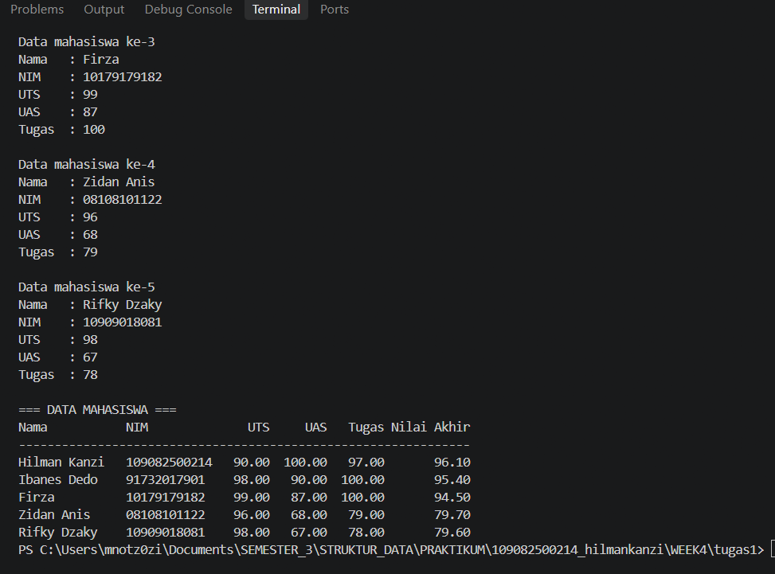
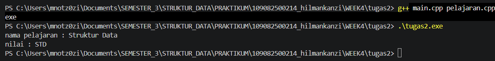
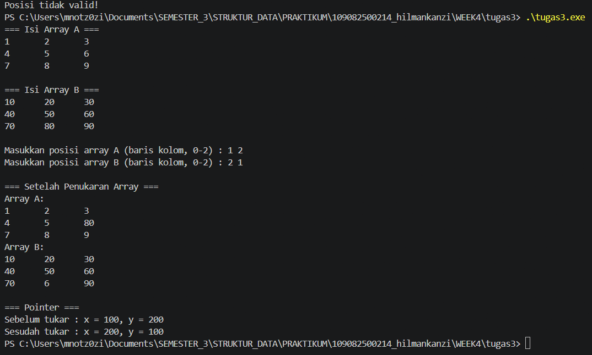

# <h1 align="center">Laporan Praktikum Modul 3 - ABSTRACT DATA TYPE (ADT) </h1>
<p align="center">Hilman Kanzi - 109082500214</p>

## Dasar Teori
Abstract Data Type (ADT) atau tipe data abstrak adalah sebuah tipe data beserta sekumpulan operasi dasar (primitif) yang berlaku pada tipe tersebut. ADT mendefinisikan kelas objek abstrak yang sepenuhnya dicirikan oleh operasi-operasi yang tersedia pada objek tersebut[1]. Dengan konsep ini, cara data direpresentasikan dapat ditentukan belakangan karena pengguna cukup memakai operasi yang disediakan tanpa mengetahui cara data disimpan[1]. Pada ADT yang lengkap, ditentukan pula invarian dari tipe dan aksioma yang berlaku.
Primitif pada ADT terdiri dari konstruktor yang membentuk nilai tipe, selector untuk mengakses komponen, mutator untuk mengubah nilai komponen, validator, destruktor, operasi baca/tulis, operator relasional, operator aritmatika, dan konversi tipe. Pada praktikum ini, `create_pelajaran` berperan sebagai konstruktor dan `tampil_pelajaran` sebagai primitif tulis.
Dalam bahasa C++, ADT diimplementasikan dengan memisahkan program menjadi tiga bagian, yaitu file header (`.h`) yang berisi spesifikasi tipe dan prototipe primitif, file realisasi (`.cpp`) yang berisi isi dari primitif, dan file driver (`main.cpp`) sebagai program utama. Pemisahan ini membuat ADT dapat dipakai ulang tanpa menulis ulang implementasinya.
Tipe pada ADT dibentuk menggunakan `struct`, yaitu tipe data bentukan pengguna yang menggabungkan beberapa field dengan tipe yang berbeda. Kumpulan data bertipe struct dapat disimpan dalam array of struct, dan setiap field diakses menggunakan operator titik (`.`).
Array dua dimensi adalah kumpulan elemen bertipe sama yang diakses menggunakan dua indeks, yaitu baris dan kolom. Pointer adalah variabel yang menyimpan alamat memori, bukan nilai data. Operator `&` menghasilkan alamat suatu variabel, sedangkan operator `*` digunakan untuk mengakses nilai pada alamat yang ditunjuk. Dengan pointer, nilai dua variabel dapat ditukar secara tidak langsung melalui variabel sementara.

## Daftar Pustaka

[1] B. Liskov and S. Zilles, "Programming with Abstract Data Types," *ACM SIGPLAN Notices*, vol. 9, no. 4, pp. 50–59, 1974.
[2] R. D. Setiyawan, D. Hermawan, A. F. Abdillah, A. Mujayanah, and R. Vindua, "Penggunaan Struktur Data Stack dalam Pemrograman C++ dengan Pendekatan Array dan Linked List," *JUTECH*, vol. 5, no. 2, pp. 484–498, Dec. 2024.

### A. ...<br/>
...
#### 1. ...
#### 2. ...
#### 3. ...

### B. ...<br/>
...
#### 1. ...
#### 2. ...
#### 3. ...

## Guided 

### 1. ...

```C++
#ifndef MAHASISWA_H_INCLUDED
#define MAHASISWA_H_INCLUDED
struct Mahasiswa {
    char nim[10];
    int nilai1, nilai2;
};

void inputMhs(Mahasiswa &m);
float rata2 (Mahasiswa m);
#endif // MAHASISWA_H_INCLUDED 
```
penjelasan singkat guided 1
Kode ini adalah file header (`mahasiswa.h`) yang berisi definisi tipe dan primitif dari ADT Mahasiswa. Baris `#ifndef MAHASISWA_H_INCLUDED` dan `#define MAHASISWA_H_INCLUDED` dengan penutup `#endif` merupakan *include guard*, yaitu penjaga agar isi header tidak terbaca ganda ketika di-include lebih dari satu kali sehingga tidak terjadi error redefinisi.
`struct Mahasiswa` mendefinisikan tipe bentukan dengan tiga field, yaitu `nim` bertipe array karakter berukuran 10, serta `nilai1` dan `nilai2` bertipe integer. Dua baris berikutnya adalah prototipe primitif. `void inputMhs(Mahasiswa &m)` adalah prosedur untuk mengisi data mahasiswa. Parameternya dilewatkan secara *by reference* (`&`) agar perubahan isi `m` di dalam prosedur tersimpan pada variabel asalnya. `float rata2(Mahasiswa m)` adalah fungsi yang menghitung rata-rata kedua nilai. Parameternya dilewatkan secara *by value* karena fungsi hanya membaca data dan mengembalikan hasil bertipe `float`.
File ini hanya memuat spesifikasi (apa yang dimiliki dan dapat dilakukan ADT), sedangkan isi (realisasi) kedua primitif ditulis terpisah pada `mahasiswa.cpp`.

### 2. ...

```C++
#include <iostream>
#include "mahasiswa.h"

using namespace std;

void inputMhs(Mahasiswa &m) {
    cout << "input Nim = ";
    cin >> m.nim;
    
    cin.clear();
    cin.ignore(1000, '\n');

    cout << "input nilai1 = ";
    cin >> m.nilai1;

    cout << "input nilai2 = ";
    cin >> m.nilai2;
}

float rata2(Mahasiswa m) {
    return float(m.nilai1 + m.nilai2) / 2;
}
```
penjelasan singkat guided 2
Kode ini adalah file realisasi (`mahasiswa.cpp`) yang berisi isi dari primitif yang sudah dideklarasikan pada `mahasiswa.h`. File ini meng-include `<iostream>` untuk input/output dan `"mahasiswa.h"` agar dapat menggunakan tipe `Mahasiswa` beserta prototipe primitifnya.
Prosedur `inputMhs` menerima parameter `Mahasiswa &m` secara *by reference* sehingga data yang dimasukkan langsung tersimpan pada variabel pemanggilnya. Prosedur ini membaca NIM ke `m.nim` menggunakan `cin`, lalu `cin.clear()` dan `cin.ignore(1000, '\n')` digunakan untuk membersihkan status error dan sisa karakter (termasuk karakter *newline*) pada buffer input agar pembacaan berikutnya tidak terganggu. Setelah itu prosedur membaca `m.nilai1` dan `m.nilai2`.
Fungsi `rata2` menerima `Mahasiswa m` secara *by value* dan mengembalikan rata-rata dari `nilai1` dan `nilai2`. Penjumlahan kedua nilai diubah ke tipe `float` terlebih dahulu (`float(m.nilai1 + m.nilai2)`) sebelum dibagi 2, sehingga hasilnya bernilai desimal dan tidak dibulatkan seperti pembagian dua bilangan integer.

### 3. ...

```C++
#include <iostream>
#include "mahasiswa.h"

using namespace std;

int main()
{
    Mahasiswa mhs;
    inputMhs(mhs);
    cout << "Rata-rata nilai = " << rata2(mhs);
    return 0;
}
```
penjelasan singkat guided 3
Kode ini adalah file driver (`main.cpp`) yang berperan sebagai program utama untuk menguji ADT Mahasiswa. File ini meng-include `<iostream>` untuk output dan `"mahasiswa.h"` agar dapat memakai tipe `Mahasiswa` serta primitif `inputMhs` dan `rata2`. Realisasi primitif tersebut berada di `mahasiswa.cpp`, sehingga `main.cpp` tidak perlu mengetahui cara kerjanya di dalam.
Pada fungsi `main`, dideklarasikan variabel `mhs` bertipe `Mahasiswa`. Prosedur `inputMhs(mhs)` dipanggil untuk mengisi NIM, `nilai1`, dan `nilai2`. Karena parameternya *by reference*, data yang diinput tersimpan pada `mhs`. Selanjutnya `rata2(mhs)` dipanggil untuk menghitung rata-rata kedua nilai, dan hasilnya ditampilkan ke layar menggunakan `cout` dengan keterangan "Rata-rata nilai = ". Program diakhiri dengan `return 0` yang menandakan program selesai tanpa error.

## Unguided 

### 1. (Buat program yang dapat menyimpan data mahasiswa (max. 10) ke dalam sebuah *array* dengan field nama, nim, uts, uas, tugas, dan nilai akhir. Nilai akhir diperoleh dari FUNGSI dengan rumus 0.3\*uts+0.4\*uas+0.3\*tugas.)
#### Source Code 1: data_mhs.h
```C++
#ifndef DATA_MHS_H_INCLUDED
#define DATA_MHS_H_INCLUDED

#include <string>
using namespace std;

const int MAX_MHS = 10;

struct mahasiswa {
    string nama;
    string nim;
    float uts;
    float uas;
    float tugas;
    float nilaiAkhir;
};

void inputMhs(mahasiswa &m);
float hitungNilaiAkhir(float uts, float uas, float tugas);
void tampilMhs(mahasiswa m);

#endif
```
### Source Code 2: data_mhs.cpp
```C++
 #include <iostream>
#include <iomanip>
#include "data_mhs.h"
using namespace std;

float hitungNilaiAkhir(float uts, float uas, float tugas) {
    return 0.3f * uts + 0.4f * uas + 0.3f * tugas;
}

void inputMhs(mahasiswa &m) {
    cout << "Nama   : ";
    getline(cin >> ws, m.nama);
    cout << "NIM    : ";
    cin >> m.nim;
    cout << "UTS    : ";
    cin >> m.uts;
    cout << "UAS    : ";
    cin >> m.uas;
    cout << "Tugas  : ";
    cin >> m.tugas;
    m.nilaiAkhir = hitungNilaiAkhir(m.uts, m.uas, m.tugas);
}

void tampilMhs(mahasiswa m) {
    cout << left << setw(15) << m.nama
         << setw(12) << m.nim
         << right << fixed << setprecision(2)
         << setw(8) << m.uts
         << setw(8) << m.uas
         << setw(8) << m.tugas
         << setw(12) << m.nilaiAkhir << endl;
}
```
### Source Code 3: main_tugas1.cpp
```C++
#include <iostream>
#include <iomanip>
#include "data_mhs.h"
using namespace std;

int main() {
    mahasiswa dataMhs[MAX_MHS];
    int n;

    do {
        cout << "Jumlah mahasiswa (1-" << MAX_MHS << ") : ";
        cin >> n;
    } while (n < 1 || n > MAX_MHS);

    for (int i = 0; i < n; i++) {
        cout << "\nData mahasiswa ke-" << i + 1 << endl;
        inputMhs(dataMhs[i]);
    }

    cout << "\n=== DATA MAHASISWA ===" << endl;
    cout << left << setw(15) << "Nama" << setw(12) << "NIM"
         << right << setw(8) << "UTS" << setw(8) << "UAS"
         << setw(8) << "Tugas" << setw(12) << "Nilai Akhir" << endl;
    cout << string(63, '-') << endl;
    for (int i = 0; i < n; i++) {
        tampilMhs(dataMhs[i]);
    }
    return 0;
}
```
### Output Unguided 1 :

##### Output 1


### Penjelasan Unguided 1
 digunakan array of struct untuk menyimpan data maksimal 10 mahasiswa yang terdiri dari nama, NIM, nilai UTS, UAS, tugas, dan nilai akhir. File data_mhs.h berisi deklarasi struktur mahasiswa, konstanta MAX_MHS, serta prototipe fungsi yang digunakan dalam program. File data_mhs.cpp berisi implementasi fungsi inputMhs() untuk memasukkan data mahasiswa, hitungNilaiAkhir() untuk menghitung nilai akhir, dan tampilMhs() untuk menampilkan data dalam bentuk tabel.
 Perhitungan nilai akhir menggunakan rumus:
 Nilai Akhir = (0,3 × UTS) + (0,4 × UAS) + (0,3 × Tugas)
 lalu file main_tugas1.cpp berfungsi sebagai program utama yang meminta jumlah mahasiswa dengan batas 1–10, menerima input data setiap mahasiswa, dan menampilkan seluruh data beserta nilai akhirnya. Hasil program ditampilkan dalam bentuk tabel agar data mahasiswa lebih terstruktur dan mudah dibaca.

### 2. (Buatlah ADT pelajaran sebagai berikut di dalam file "pelajaran.h":)

### Source Code 1: pelajaran.h
```C++
#ifndef PELAJARAN_H_INCLUDED
#define PELAJARAN_H_INCLUDED

#include <string>
using namespace std;

struct pelajaran {
    string namaMapel;
    string kodeMapel;
};

pelajaran create_pelajaran(string namapel, string kodepel);

void tampil_pelajaran(pelajaran pel);

#endif // PELAJARAN_H_INCLUDED

```
### Source Code 2: pelajaran.cpp
```C++
#include <iostream>
#include "pelajaran.h"
using namespace std;

pelajaran create_pelajaran(string namapel, string kodepel) {
    pelajaran p;
    p.namaMapel = namapel;
    p.kodeMapel = kodepel;
    return p;
}

void tampil_pelajaran(pelajaran pel) {
    cout << "nama pelajaran : " << pel.namaMapel << endl;
    cout << "nilai : " << pel.kodeMapel << endl;
}
```
### Source Code 3: main.cpp
```C++
#include <iostream>
#include "pelajaran.h"
using namespace std;

int main() {
    string namapel = "Struktur Data";
    string kodepel = "STD";
    pelajaran pel = create_pelajaran(namapel, kodepel);
    tampil_pelajaran(pel);

    return 0;
}
```
### Output Unguided 2 :

##### Output 1


### Penjelasan Unguided 2
Program yg saya buat adalah untuk membuat ADT pelajaran untuk menyimpan nama dan kode mata pelajaran. File pelajaran.h berisi deklarasi struktur dan fungsi, sedangkan pelajaran.cpp berisi implementasi fungsi untuk membuat dan menampilkan data pelajaran. File main.cpp digunakan untuk mengisi data dengan nama pelajaran "Struktur Data" dan kode "STD", kemudian menampilkannya ke terminal. Hasil output menunjukkan bahwa data berhasil dibuat dan ditampilkan sesuai input.

### 3. (Buatlah program dengan ketentuan:
- 2 buah *array* 2D *integer* berukuran 3x3 dan 2 buah *pointer integer*
- fungsi/prosedur yang menampilkan isi sebuah *array integer* 2D
- fungsi/prosedur yang akan menukarkan isi dari 2 *array integer* 2D pada posisi tertentu
- fungsi/prosedur yang akan menukarkan isi dari variabel yang ditunjuk oleh 2 buah *pointer*)

```C++
#include <iostream>
using namespace std;

const int N = 3;

void tampilArray(int arr[N][N]) {
    for (int i = 0; i < N; i++) {
        for (int j = 0; j < N; j++) {
            cout << arr[i][j] << "\t";
        }
        cout << endl;
    }
}


void tukarArray(int A[N][N], int B[N][N],
                int baris1, int kolom1, int baris2, int kolom2) {
    int temp = A[baris1][kolom1];
    A[baris1][kolom1] = B[baris2][kolom2];
    B[baris2][kolom2] = temp;
}

void tukarPointer(int *p1, int *p2) {
    int temp = *p1;
    *p1 = *p2;
    *p2 = temp;
}

int main() {
    int A[N][N] = {{1, 2, 3}, {4, 5, 6}, {7, 8, 9}};
    int B[N][N] = {{10, 20, 30}, {40, 50, 60}, {70, 80, 90}};
    int *ptr1, *ptr2;
    int baris1, kolom1, baris2, kolom2;

    cout << "=== Isi Array A ===" << endl;
    tampilArray(A);
    cout << "\n=== Isi Array B ===" << endl;
    tampilArray(B);

    cout << "\nMasukkan posisi array A (baris kolom, 0-2) : ";
    cin >> baris1 >> kolom1;
    cout << "Masukkan posisi array B (baris kolom, 0-2) : ";
    cin >> baris2 >> kolom2;

    if (baris1 < 0 || baris1 >= N || kolom1 < 0 || kolom1 >= N ||
        baris2 < 0 || baris2 >= N || kolom2 < 0 || kolom2 >= N) {
        cout << "Posisi tidak valid!" << endl;
        return 1;
    }

    tukarArray(A, B, baris1, kolom1, baris2, kolom2);

    cout << "\n=== Setelah Penukaran Array ===" << endl;
    cout << "Array A:" << endl;
    tampilArray(A);
    cout << "Array B:" << endl;
    tampilArray(B);

    int x = 100, y = 200;
    ptr1 = &x;
    ptr2 = &y;
    cout << "\n=== Pointer ===" << endl;
    cout << "Sebelum tukar : x = " << *ptr1 << ", y = " << *ptr2 << endl;
    tukarPointer(ptr1, ptr2);
    cout << "Sesudah tukar : x = " << *ptr1 << ", y = " << *ptr2 << endl;

    return 0;
}
```
### Output Unguided 3 :

##### Output 1
/(nama repository github kalian)/blob/main/(path folder menyimpan screenshot output)/(nama file screenshot output).png)

contoh :


### Penjelasan Unguided 3
Program ini menggunakan dua array 2D berukuran 3×3 dan dua pointer integer. Fungsi `tampilArray()` digunakan untuk menampilkan isi array, sedangkan `tukarArray()` menukarkan nilai dari dua array berdasarkan posisi baris dan kolom yang diinputkan. Program juga menggunakan fungsi `tukarPointer()` untuk menukarkan nilai dua variabel melalui pointer. Hasil program menampilkan isi array sebelum dan sesudah pertukaran serta perubahan nilai variabel `x` dan `y` dari 100 dan 200 menjadi 200 dan 100.

## Kesimpulan
praktikum kali ini,modul 3 tentang pengenalan IDE Code::Blocks dan bahasa pemrograman C++, dapat disimpulkan bahwa praktikum ini memberikan pemahaman mengenai dasar pemrograman C++, konsep Abstract Data Type (ADT), penggunaan struct, array, fungsi, dan pointer. Pada praktikum guided, saya mempelajari penerapan ADT Mahasiswa melalui pemisahan file header, implementasi fungsi, dan program utama. Pada praktikum unguided, saya berhasil membuat program untuk menyimpan dan menghitung nilai akhir mahasiswa menggunakan array of struct, membuat ADT Pelajaran untuk menyimpan nama dan kode mata pelajaran, serta menggunakan array dua dimensi dan pointer untuk menampilkan dan menukarkan nilai. Melalui praktikum ini, saya memahami pentingnya pembagian program ke dalam beberapa fungsi dan file agar kode lebih terstruktur, mudah dipahami, serta dapat digunakan kembali.
...

## Referensi
[1] Liskov, B., dan Zilles, S. (1974). “Programming with Abstract Data Types.” ACM SIGPLAN Notices, 9(4), 50–59.
[2] Indahyati, U., dan Rahmawati, Y. (2020). Buku Ajar Algoritma dan Pemrograman dalam Bahasa C++. Sidoarjo: Umsida Press. https://doi.org/10.21070/2020/978-623-6833-67-4
[3] Triase. (2020). Diktat Edisi Revisi: Struktur Data. Medan: Universitas Islam Negeri Sumatera Utara Medan.