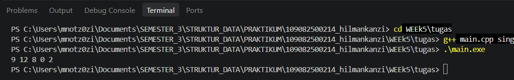
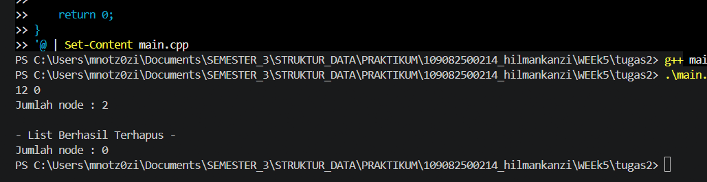

# <h1 align="center">Laporan Praktikum Modul 4 - SINGLY LINKED LIST (BAGIAN PERTAMA) </h1>
<p align="center">Hilman Kanzi - 109082500214</p>

## Dasar Teori
Linked list atau yang disebut juga senarai berantai adalah salah satu bentuk struktur data yang berisi kumpulan data yang tersusun secara sekuensial, saling bersambungan, dinamis, dan terbatas[1]. Linked list terdiri dari sejumlah node atau simpul yang dihubungkan secara linier dengan bantuan pointer. Penggunaan linked list memungkinkan pengelolaan data yang lebih fleksibel dan efisien, terutama untuk operasi menambah, mencari, dan menghapus data[2].

### A. ...<br/>
...
#### 1. ...
#### 2. ...
#### 3. ...

### B. ...<br/>
...
#### 1. ...
#### 2. ...
#### 3. ...

## Guided 

### 1. Header ADT Linked List (list.h)

```C++
#ifndef LIST_H
#define LIST_H
#define Nil NULL

#include <iostream>
using namespace std;

struct mahasiswa {
    string nama;
    string nim;
    int umur;
};

typedef mahasiswa dataMahasiswa; 

typedef struct node *address; 

struct node { 
    dataMahasiswa isidata;
    address next;
};

struct linkedList { 
    address first;
};

bool isEmpty(linkedList list);
void createList(linkedList &list);
address alokasi(string nama, string nim, int umur);
void dealokasi(address &node);
void printInfo(linkedList list);
void insertFirst(linkedList &list, address nodeBaru);
void insertAfter(linkedList &list, address nodeBaru, address Prev);
void insertLast(linkedList &list, address nodeBaru);

void delFirst(linkedList &list);
void delLast(linkedList &list);
void delAfter(linkedList &list, address nodeHapus, address nodePrev);
int nbList(linkedList list);
void deleteList(linkedList &list);

#endif
```
### PENJELASAN
File header berisi deklarasi struct mahasiswa sebagai isi data, struct node (berisi isidata dan next), struct linkedList (berisi pointer first), serta prototype seluruh fungsi dan prosedur. #ifndef mencegah header ter-include lebih dari sekali.

### 2. Implementasi Fungsi dan Prosedur (list.cpp)

```C++
#include "list.h"
#include <iostream>
using namespace std;

bool isEmpty(linkedList List) {
    if (List.first == Nil) {
        return true;
    } else {
        return false;
    }
}


void createList(linkedList &List) {

    List.first = Nil;
}

// Pembuatan node baru dengan menerapkan manajemen memori
address alokasi(string nama, string nim, int umur) {

    address nodeBaru = new node;
    nodeBaru->isidata.nama = nama;
    nodeBaru->isidata.nim = nim;
    nodeBaru->isidata.umur = umur;
    nodeBaru->next = Nil;
    return nodeBaru;
}

// Penghapusan node dengan menerapkan manajemen memori
void dealokasi(address &node) {
    /* I.S. P terdefinisi
       F.S. memori yang digunakan node dikembalikan ke sistem */
    node->next = Nil;
    delete node;
}

// Prosedur-prosedur untuk insert / menambahkan node baru ke dalam list
void insertFirst(linkedList &List, address nodeBaru) {
    /* I.S. sembarang, P sudah dialokasikan
       F.S. menempatkan elemen list (node) pada awal list */
    nodeBaru->next = List.first;
    List.first = nodeBaru;
}

void insertAfter(linkedList &List, address nodeBaru, address Prev) {
    /* I.S. sembarang, nodeBaru dan Prev adalah salah satu elemen list (node)
       F.S. menempatkan elemen (node) sesudah elemen node Prev */
    if (Prev != Nil) {
        nodeBaru->next = Prev->next;
        Prev->next = nodeBaru;
    } else {
        cout << "Node sebelumnya tidak valid!" << endl;
    }
}

void insertLast(linkedList &List, address nodeBaru) {
    /* I.S. sembarang, nodeBaru sudah dialokasikan
       F.S. menempatkan elemen baru pada akhir list */
    if (isEmpty(List)) {
        List.first = nodeBaru;
    } else {
        address nodeBantu = List.first;
        while (nodeBantu->next != Nil) {
            nodeBantu = nodeBantu->next;
        }
        nodeBantu->next = nodeBaru;
    }
}

// Prosedur-prosedur untuk delete / menghapus node yang ada di dalam list
void delFirst(linkedList &List) {
    /* I.S. list tidak kosong
       F.S. node pertama dari list terhapus */
    address nodeHapus;
    if (isEmpty(List) == false) {
        nodeHapus = List.first;
        List.first = List.first->next;
        nodeHapus->next = Nil;
        dealokasi(nodeHapus);
    } else {
        cout << "List kosong!" << endl;
    }
}

void delLast(linkedList &List) {
    /* I.S. list tidak kosong
       F.S. node terakhir di list terhapus */
    address nodeHapus, nodePrev;
    if (isEmpty(List) == false) {
        nodeHapus = List.first;
        if (nodeHapus->next == Nil) {
            List.first->next = Nil;
            dealokasi(nodeHapus);
        } else {
            while (nodeHapus->next != Nil) {
                nodePrev = nodeHapus;
                nodeHapus = nodeHapus->next;
            }
            nodePrev->next = Nil;
            dealokasi(nodeHapus);
        }
    } else {
        cout << "List kosong" << endl;
    }
}

void delAfter(linkedList &List, address nodeHapus, address nodePrev) {
    /* I.S. list tidak kosong, Prev alamat salah satu elemen list
       F.S. nodeBantu adalah alamat dari Prev->next,
       menghapus Prev->next dari list */
    if (isEmpty(List) == true) {
        cout << "List kosong!" << endl;
    } else {
        if (nodePrev != Nil && nodePrev->next != Nil) {
            nodeHapus = nodePrev->next;
            nodePrev->next = nodeHapus->next;
            nodeHapus->next = Nil;
            dealokasi(nodeHapus);
        } else {
            cout << "Node sebelumnya (prev) tidak valid!" << endl;
        }
    }
}

// Prosedur untuk menampilkan isi list
void printInfo(linkedList List) {    /* I.S. mungkin kosong
       F.S. jika list tidak kosong menampilkan semua info yang ada pada list */
    if (isEmpty(List)) {
        cout << "List kosong." << endl;
    } else {
        address nodeBantu = List.first;
        while (nodeBantu != Nil) {
            cout << "Nama : " << nodeBantu->isidata.nama
                 << ", NIM : " << nodeBantu->isidata.nim
                 << ", Usia : " << nodeBantu->isidata.umur << endl;
            nodeBantu = nodeBantu->next;
        }
    }
}

// Function untuk menampilkan jumlah node di dalam list
int nbList(linkedList List) {
    /* I.S. list sudah ada
       F.S. menampilkan jumlah node di dalam list */
    int count = 0;
    address nodeBantu = List.first;
    while (nodeBantu != Nil) {
        count++;
        nodeBantu = nodeBantu->next;
    }
    return count;
}

// Prosedur untuk menghapus list (menghapus semua node di dalam list)
void deleteList(linkedList &List) {
    /* I.S. list sudah ada
       F.S. menghapus semua node di dalam list */
    address nodeBantu, nodeHapus;
    nodeBantu = List.first;
    while (nodeBantu != Nil) {
        nodeHapus = nodeBantu;
        nodeBantu = nodeBantu->next;
        dealokasi(nodeHapus);
    }
    List.first = Nil;
    cout << "List sudah terhapus!" << endl;
    
}
```
### PENJELASAN
File ini berisi implementasi seluruh prosedur yang dideklarasikan di list.h: pembuatan list (createList), alokasi dan dealokasi node, insert (insertFirst, insertAfter, insertLast), delete (delFirst, delLast, delAfter), menampilkan isi list (printInfo), menghitung jumlah node (nbList), dan menghapus seluruh list (deleteList).

### 3. Program Utama (main.cpp)

```C++
#include "list.h"

#include <iostream>
using namespace std;

int main(){
    linkedList List;
    address nodeA, nodeB, nodeC, nodeD, nodeE = Nil;
    createList(List);

    dataMahasiswa mhs;

    nodeA = alokasi("Dhimas", "2311102151", 20);
    nodeB = alokasi("Arvin", "22111010014", 21);
    nodeC = alokasi("Rizal", "2311100029", 20);
    nodeD = alokasi("Satrio", "2211102173", 21);
    nodeE = alokasi("Joshua", "2311102133", 21);

    insertFirst(List, nodeA);
    insertLast(List, nodeB);
    insertAfter(List, nodeC, nodeA);
    insertAfter(List, nodeD, nodeC);
    insertLast(List, nodeE);

   cout << "--- ISI LIST SETELAH DILAKUKAN INSERT ---" << endl;
    printInfo(List); // Ubah printList menjadi printInfo
    cout << "jumlah node : " << nbList(List) << endl;
    cout << endl;

// ... (bagian delete di bawahnya juga sesuaikan jika perlu)

    cout << "--- ISI LIST SETELAH DILAKUKAN DELETE ---" << endl;
    printInfo(List); // Ubah printList menjadi printInfo
    cout << "jumlah node : " << nbList(List) << endl;
    cout << endl;

    deleteList(List);
    cout << "--- ISI LIST SETELAH DILAKUKAN HAPUS LIST ---" << endl;
    printInfo(List);
    cout << "jumlah node : " << nbList(List) << endl;
    cout << endl;

    return 0;
}
```
### PENJELASAN
Program utama membuat list kosong dan lima node data mahasiswa, lalu menyusunnya dengan insertFirst, insertLast, dan insertAfter sehingga urutan list menjadi Dhimas, Rizal, Satrio, Arvin, Joshua. Isi list dan jumlah node ditampilkan dengan printInfo dan nbList, kemudian seluruh node dihapus dengan deleteList sehingga list kosong dan jumlah node menjadi 0.

## Unguided 

### 1. (Buatlah ADT Singly Linked list sebagai berikut di dalam file “Singlylist.h”,Kemudian buatlah implementasi dari procedure-procedure yang digunakan didalam file “Singlylist.cpp”, Kemudian buat program utama didalam file “main.cpp” dengan implementasi sebagai berikut)

## Singlylist.h
```C++
#ifndef SINGLYLIST_H_INCLUDED
#define SINGLYLIST_H_INCLUDED

#include <iostream>
using namespace std;

#define Nil NULL

typedef int infotype;
typedef struct ElmList *address;

struct ElmList {
    infotype info;
    address next;
};

struct List {
    address First;
};

void createList(List &L);
address alokasi(infotype x);
void dealokasi(address &P);
void printInfo(List L);
void insertFirst(List &L, address P);

#endif // SINGLYLIST_H_INCLUDED
```
## Singlylist.cpp
```C++
#include "Singlylist.h"

void createList(List &L) {
    L.First = Nil;
}

address alokasi(infotype x) {
    address P = new ElmList;
    P->info = x;
    P->next = Nil;
    return P;
}

void dealokasi(address &P) {
    delete P;
    P = Nil;
}

void printInfo(List L) {
    address P = L.First;
    while (P != Nil) {
        cout << P->info << " ";
        P = P->next;
    }
    cout << endl;
}

void insertFirst(List &L, address P) {
    P->next = L.First;
    L.First = P;
}
```
## main.cpp
```C++
#include "Singlylist.h"

int main() {
    List L;
    address P1, P2, P3, P4, P5 = Nil;
    createList(L);

    P1 = alokasi(2);
    insertFirst(L, P1);

    P2 = alokasi(0);
    insertFirst(L, P2);

    P3 = alokasi(8);
    insertFirst(L, P3);

    P4 = alokasi(12);
    insertFirst(L, P4);

    P5 = alokasi(9);
    insertFirst(L, P5);

    printInfo(L);
    return 0;
}
```
### Output Unguided 1 :

##### Output 1


## penjelasan unguided 1 
Pada Unguided 1, ADT singly linked list dibuat dengan infotype bertipe int. Lima node dengan nilai 2, 0, 8, 12, dan 9 dimasukkan satu per satu menggunakan insertFirst. Karena setiap node baru selalu menjadi node pertama, urutan list menjadi kebalikan dari urutan insert, yaitu 9, 12, 8, 0, 2, dan hasil printInfo sesuai dengan output yang diharapkan.

### 2. (Menghapus node 9 dengan deleteFirst(), node 2 dengan deleteLast(), dan node 8 dengan deleteAfter(), lalu menampilkan jumlah node dengan nbList() dan menghapus seluruh node dengan deleteList())

## Singlylist.h
```C++
#ifndef SINGLYLIST_H_INCLUDED
#define SINGLYLIST_H_INCLUDED

#include <iostream>
using namespace std;

#define Nil NULL

typedef int infotype;
typedef struct ElmList *address;

struct ElmList {
    infotype info;
    address next;
};

struct List {
    address First;
};

void createList(List &L);
address alokasi(infotype x);
void dealokasi(address &P);
void printInfo(List L);
void insertFirst(List &L, address P);
void deleteFirst(List &L, address &P);
void deleteLast(List &L, address &P);
void deleteAfter(List &L, address Prec, address &P);
int nbList(List L);
void deleteList(List &L);

#endif 
```
## inglylist.cpp
```C++
#include "Singlylist.h"

void createList(List &L) {
    L.First = Nil;
}

address alokasi(infotype x) {
    address P = new ElmList;
    P->info = x;
    P->next = Nil;
    return P;
}

void dealokasi(address &P) {
    delete P;
    P = Nil;
}

void printInfo(List L) {
    address P = L.First;
    while (P != Nil) {
        cout << P->info << " ";
        P = P->next;
    }
    cout << endl;
}

void insertFirst(List &L, address P) {
    P->next = L.First;
    L.First = P;
}

void deleteFirst(List &L, address &P) {
    if (L.First != Nil) {
        P = L.First;
        L.First = P->next;
        P->next = Nil;
    } else {
        P = Nil;
    }
}

void deleteLast(List &L, address &P) {
    if (L.First == Nil) {
        P = Nil;
    } else if (L.First->next == Nil) {   
        P = L.First;
        L.First = Nil;
    } else {
        address Q = L.First;
        while (Q->next->next != Nil) {
            Q = Q->next;
        }
        P = Q->next;
        Q->next = Nil;
    }
}

void deleteAfter(List &L, address Prec, address &P) {
    if (Prec != Nil && Prec->next != Nil) {
        P = Prec->next;
        Prec->next = P->next;
        P->next = Nil;
    } else {
        P = Nil;
    }
}

int nbList(List L) {
    int n = 0;
    address P = L.First;
    while (P != Nil) {
        n++;
        P = P->next;
    }
    return n;
}

void deleteList(List &L) {
    address P;
    while (L.First != Nil) {
        deleteFirst(L, P);
        dealokasi(P);
    }
}
```
## main.cpp
```C++
#include "Singlylist.h"

int main() {
    List L;
    address P1, P2, P3, P4, P5 = Nil;
    createList(L);

    P1 = alokasi(2);
    insertFirst(L, P1);
    P2 = alokasi(0);
    insertFirst(L, P2);
    P3 = alokasi(8);
    insertFirst(L, P3);
    P4 = alokasi(12);
    insertFirst(L, P4);
    P5 = alokasi(9);
    insertFirst(L, P5);
    // List: 9 12 8 0 2

    address P;

    deleteFirst(L, P);          
    dealokasi(P);

    deleteLast(L, P);           
    dealokasi(P);

    deleteAfter(L, P4, P);      
    dealokasi(P);

    printInfo(L);
    cout << "Jumlah node : " << nbList(L) << endl;

    deleteList(L);
    cout << endl << "- List Berhasil Terhapus -" << endl;
    cout << "Jumlah node : " << nbList(L) << endl;

    return 0;
}
```
### Output Unguided 2 :

##### Output 1


## penjelasan unguided 2
Unguided 2, ADT dari soal pertama ditambah prosedur deleteFirst, deleteLast, deleteAfter, nbList, dan deleteList. Dari list 9, 12, 8, 0, 2, node 9 dihapus dengan deleteFirst, node 2 dengan deleteLast, dan node 8 dengan deleteAfter (node 8 berada tepat setelah node 12), sehingga tersisa list 12, 0 dengan jumlah node 2. Terakhir deleteList menghapus seluruh node sehingga nbList bernilai 0.


## Kesimpulan
Singly linked list menyimpan data dalam node-node yang saling terhubung melalui satu pointer next, dengan pointer First sebagai penanda node pertama. Pada praktikum ini, list dibuat dengan alokasi memori dinamis sehingga ukurannya dapat bertambah dan berkurang sesuai kebutuhan. Operasi insert dan delete dilakukan dengan mengatur ulang pointer antar node tanpa menggeser data lain seperti pada array. Setiap node yang dihapus juga harus didealokasi agar memori dikembalikan ke sistem dan tidak terjadi kebocoran memori.
...

## Referensi
[1] Triase. (2020). Diktat Edisi Revisi : STRUKTUR DATA. Medan: UNIVERSITAS ISLAM NEGERI SUMATERA UTARA MEDAN. Diakses melalui http://repository.uinsu.ac.id/9717/2/Diktat%20Struktur%20Data.pdf. <br>[2] Fitra, M. R. A., Effendi, A. A. S., & Ramadhani, F. (2024). Implementasi Python dalam Pengolahan Data Pribadi Mahasiswa Ilmu Komputer Angkatan 23 pada Universitas Negeri Medan Menggunakan Struktur Data Linked List. JATI (Jurnal Mahasiswa Teknik Informatika), 9(1), 51-58. https://doi.org/10.36040/jati.v9i1.12164. <br>[3] Setiyawan, R. D., Hermawan, D., Abdillah, A. F., Mujayanah, A., & Vindua, R. (2024). Penggunaan Struktur Data Stack dalam Pemrograman C++ dengan Pendekatan Array dan Linked List. JUTECH: Journal Education and Technology, 5(2), 484-498. https://doi.org/10.31932/jutech.v5i2.4263.