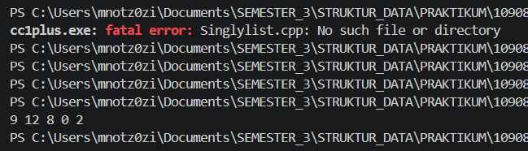
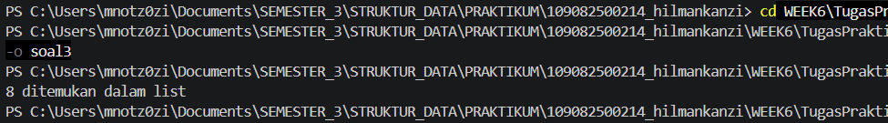
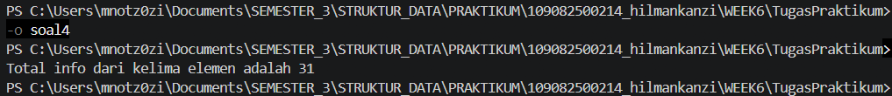

# <h1 align="center">Laporan Praktikum Modul 5 - SINGLY LINKED LIST (BAGIAN KEDUA) </h1>
<p align="center">Hilman Kanzi - 109082500214</p>

## Dasar Teori
Linked list atau yang disebut juga senarai berantai adalah salah satu bentuk struktur data yang berisi kumpulan data yang tersusun secara sekuensial, saling bersambungan, dinamis, dan terbatas[1]. Linked list terdiri dari sejumlah node atau simpul yang dihubungkan secara linier dengan bantuan pointer. Penggunaan linked list memungkinkan pengelolaan data yang lebih fleksibel dan efisien, terutama untuk operasi menambah, mencari, dan menghapus data[2].

### A. Searching pada Singly Linked List<br/>
Searching adalah operasi dasar pada list yang dilakukan dengan mencari node tertentu. Karena singly linked list hanya bisa ditelusuri satu arah, pencarian dilakukan dengan mengunjungi node satu per satu mulai dari First dan berhenti ketika node yang dicari ditemukan atau ketika Nil tercapai. Hasil pencarian ini juga mempermudah operasi lain seperti insert after, delete after, dan update.
#### 1. Sequential Search
Sequential search adalah algoritma pencarian paling dasar dan sederhana, yaitu mencari data dari elemen paling awal hingga paling akhir sampai data ditemukan, tanpa data harus diurutkan terlebih dahulu[4]. Pada linked list, cara ini sesuai dengan sifat pointer next yang hanya bisa ditelusuri maju.
#### 2. Fungsi findElm
Fungsi findElm(L, x) menelusuri list dari First dan membandingkan info setiap node dengan nilai x. Jika ditemukan, fungsi mengembalikan alamat node tersebut, dan jika tidak ditemukan fungsi mengembalikan Nil. Penelusuran dihentikan begitu data ketemu agar tidak ada perbandingan yang sia-sia[4].
#### 3. Kompleksitas Pencarian
Kasus terbaik terjadi jika data berada di posisi pertama sehingga hanya perlu satu perbandingan, sedangkan kasus terburuk terjadi jika data berada di posisi terakhir atau tidak ada sehingga seluruh node harus diperiksa sebanyak jumlah elemen list[4]. Karena itu waktu pencarian pada singly linked list bertambah seiring jumlah node.

### B. ADT dan traversal pada Singly Linked list<br/>
Abstract Data Type (ADT) singly linked list memisahkan deklarasi tipe dan prototype operasi (Singlylist.h) dari implementasinya (Singlylist.cpp), sedangkan program utama (main.cpp) hanya memanfaatkan operasi tersebut.
#### 1. Alokasi dan Dealokasi Node
Node dibuat secara dinamis dengan new melalui fungsi alokasi, dan dikembalikan ke sistem dengan delete melalui dealokasi. Alokasi memori dinamis inilah yang membuat linked list unggul dalam fleksibilitas ukuran dibandingkan array yang ukurannya tetap[3].
#### 2. Insert First
insertFirst menempatkan node baru di awal list dengan mengarahkan next node baru ke First yang lama, lalu memindahkan First ke node baru. Akibatnya, node yang dimasukkan paling akhir menjadi node paling depan, sehingga urutan list kebalikan dari urutan insert.
#### 3. Traversal
Traversal adalah penelusuran seluruh node dari First sampai Nil menggunakan pointer bantu. Traversal dipakai untuk menampilkan isi list (printInfo) dan juga untuk memproses seluruh elemen, misalnya menjumlahkan info dari semua node (sumInfo).

## Guided 

### 1. listbuah.h

```C++
#ifndef LISTBUAH_H
#define LISTBUAH_H
#define Nil NULL

#include <iostream>
#include <string>
using namespace std;

struct buah{
    string nama;
    int jumlah; 
    float harga;
};

typedef buah dataBuah; 

typedef struct node *address; 

struct node{ 
    dataBuah isidata;
    address next;
};

struct linkedlist{ 
    address first;
};

bool isEmpty(linkedlist List);
void createList(linkedlist &List);
address alokasi(string nama, int jumlah, float harga);
void dealokasi(address &node);
void printList(linkedlist List);
void insertFirst(linkedlist &List, address nodeBaru);
void insertAfter(linkedlist &List, address nodeBaru, address nodePrev);
void insertLast(linkedlist &List, address nodeBaru);
void delFirst(linkedlist &List);
void delLast(linkedlist &List);
void delAfter(linkedlist &List, address nodeHapus, address nodePrev);
int nbList(linkedlist List);
void deleteList(linkedlist &List);

void updateFirst(linkedlist List);
void updateLast(linkedlist List);
void updateAfter(linkedlist List, address prev);

void FindNodeByData(linkedlist list, string data);
void FindNodeByAddress(linkedlist list, address node);
void FindNodeByRange(linkedlist list, float hargaAwal, float hargaAkhir);

#endif
```
## Penjelasan
File header berisi deklarasi struct buah sebagai isi data (nama, jumlah, harga), struct node yang berisi isidata dan pointer next, struct linkedlist yang berisi pointer first, serta prototype seluruh fungsi dan prosedur untuk insert, update, searching, dan delete. #ifndef mencegah header ter-include lebih dari sekali.

### 2. listbuah.cpp

```C++
#ifndef LISTBUAH_H
#define LISTBUAH_H
#define Nil NULL

#include <iostream>
#include <string>
using namespace std;

struct buah{
    string nama;
    int jumlah; 
    float harga;
};

typedef buah dataBuah; 

typedef struct node *address; 

struct node{ 
    dataBuah isidata;
    address next;
};

struct linkedlist{ 
    address first;
};

bool isEmpty(linkedlist List);
void createList(linkedlist &List);
address alokasi(string nama, int jumlah, float harga);
void dealokasi(address &node);
void printList(linkedlist List);
void insertFirst(linkedlist &List, address nodeBaru);
void insertAfter(linkedlist &List, address nodeBaru, address nodePrev);
void insertLast(linkedlist &List, address nodeBaru);
void delFirst(linkedlist &List);
void delLast(linkedlist &List);
void delAfter(linkedlist &List, address nodeHapus, address nodePrev);
int nbList(linkedlist List);
void deleteList(linkedlist &List);

void updateFirst(linkedlist List);
void updateLast(linkedlist List);
void updateAfter(linkedlist List, address prev);

void FindNodeByData(linkedlist list, string data);
void FindNodeByAddress(linkedlist list, address node);
void FindNodeByRange(linkedlist list, float hargaAwal, float hargaAkhir);

#endif
```
## Penjelasan
file berisi implementasi seluruh prosedur yang dideklarasikan di listBuah.h. Insert (insertFirst, insertAfter, insertLast) menyambungkan node baru dengan mengatur pointer next. Update (updateFirst, updateLast, updateAfter) mengubah isi data node yang dituju. Searching (FindNodeByData, FindNodeByAddress, FindNodeByRange) menelusuri node satu per satu dari first untuk mencari berdasarkan nama, alamat, atau rentang harga. Delete (delFirst, delLast, delAfter, deleteList) melepas node dari list lalu mengembalikan memorinya dengan dealokasi.

### 3. main.cpp

```C++
  #include "listBuah.h"

  #include<iostream>
  using namespace std;

  int main(){
      linkedlist List;
      address nodeA, nodeB, nodeC, nodeD, nodeE = Nil;
      createList(List);

      dataBuah dtBuah;

      nodeA = alokasi("Jeruk", 100, 3000);
      nodeB = alokasi("Apel", 75, 4000);
      nodeC = alokasi("Pir", 87, 5000);
      nodeD = alokasi("Semangka", 43, 11500);
      nodeE = alokasi("Durian", 15, 31450);

      insertFirst(List, nodeA);
      insertLast(List, nodeB);
      insertAfter(List, nodeC, nodeA);
      insertAfter(List, nodeD, nodeC);
      insertLast(List, nodeE);

      cout << "--- ISI LIST SETELAH DILAKUKAN INSERT ---" << endl;
      printList(List);
      cout << "jumlah node : " << nbList(List) << endl;
      cout << endl;

      updateFirst(List);
      printList(List);
      updateLast(List);
      printList(List);
      updateAfter(List, nodeD);
      printList(List);

      cout << "--- ISI LIST SETELAH DILAKUKAN UPDATE ---" << endl;
      printList(List);
      cout << "jumlah node : " << nbList(List) << endl;
      cout << endl;

      FindNodeByData(List, "kelapa");
      FindNodeByAddress(List, nodeC);
      FindNodeByRange(List, 5000, 10000);

      delFirst(List);
      printList(List);
      delLast(List);
      printList(List);
      delAfter(List, nodeD, nodeC);
      printList(List);

      cout << "--- ISI LIST SETELAH DILAKUKAN DELETE ---" << endl;
      printList(List);
      cout << "jumlah node : " << nbList(List) << endl;
      cout << endl;

      deleteList(List);
      cout << "--- ISI LIST SETELAH DILAKUKAN HAPUS LIST ---" << endl;
      printList(List);
      cout << "jumlah node : " << nbList(List) << endl;
      cout << endl;

      return 0;
  }
```
## Penjelasan
Program membuat lima node data buah lalu menyusunnya dengan insertFirst, insertLast, dan insertAfter sehingga urutan list menjadi Jeruk, Pir, Semangka, Apel, Durian. Setelah itu data node diubah dengan operasi update, dicari berdasarkan nama ("kelapa"), alamat (nodeC), dan rentang harga 5000 sampai 10000, kemudian node dihapus dengan delFirst, delLast, dan delAfter. Terakhir deleteList menghapus seluruh node sehingga list kosong dan jumlah node menjadi 0.

## Unguided 

### 1. (Program ADT Singly Linked List Menggunakan insertFirst dan printInfo)
## Source Code singlylist.h
```C++
#ifndef SINGLYLIST_H_INCLUDED
#define SINGLYLIST_H_INCLUDED

#include <iostream>
using namespace std;

#define Nil NULL

typedef int infotype;
typedef struct ElmList *address;

struct ElmList {
    infotype info;
    address next;
};

struct List {
    address First;
};

void createList(List &L);
address alokasi(infotype x);
void dealokasi(address &P);
void printInfo(List L);
void insertFirst(List &L, address P);

#endif
```
## Source Code singlylist.cpp
```C++
#include "Singlylist.h"

void createList(List &L) {
    L.First = Nil;
}

address alokasi(infotype x) {
    address P = new ElmList;
    P->info = x;
    P->next = Nil;
    return P;
}

void dealokasi(address &P) {
    delete P;
    P = Nil;
}

void printInfo(List L) {
    address P = L.First;
    while (P != Nil) {
        cout << P->info << " ";
        P = P->next;
    }
    cout << endl;
}

void insertFirst(List &L, address P) {
    P->next = L.First;
    L.First = P;
}

address findElm(List L, infotype x) {
    address P = L.First;
    while (P != Nil) {
        if (P->info == x) {
            return P;
        }
        P = P->next;
    }
    return Nil;
}

int sumInfo(List L) {
    int total = 0;
    address P = L.First;
    while (P != Nil) {
        total = total + P->info;
        P = P->next;
    }
    return total;
}
```
## Source Code main.cpp
```C++
#include "Singlylist.h"

int main() {
    List L;
    address P1, P2, P3, P4, P5 = Nil;
    createList(L);

    P1 = alokasi(2);
    insertFirst(L, P1);

    P2 = alokasi(0);
    insertFirst(L, P2);

    P3 = alokasi(8);
    insertFirst(L, P3);

    P4 = alokasi(12);
    insertFirst(L, P4);

    P5 = alokasi(9);
    insertFirst(L, P5);

    printInfo(L);
    return 0;
}
```
### Output Unguided 1 :

##### Output 1


## Penjelasan 
unguided 1, ADT singly linked list dibuat dengan infotype bertipe int, lalu lima node bernilai 2, 0, 8, 12, dan 9 dimasukkan satu per satu dengan insertFirst. Karena setiap node baru selalu menjadi node pertama, urutan list menjadi 9, 12, 8, 0, 2 dan hasil printInfo sesuai dengan output yang diharapkan.

### 2. (Program Pencarian Elemen Menggunakan findElm)
## Penambahan pada singlylist.h
```C++
address findElm(List L, infotype x);
```
## Penambahan pada singlylist.cpp
```C++
address findElm(List L, infotype x) {
    address P = L.First;
    while (P != Nil) {
        if (P->info == x) {
            return P;
        }
        P = P->next;
    }
    return Nil;
}
```
## Source Code main.cpp
```C++
#include "Singlylist.h"

int main() {
    List L;
    address P1, P2, P3, P4, P5 = Nil;
    createList(L);

    P1 = alokasi(2);
    insertFirst(L, P1);

    P2 = alokasi(0);
    insertFirst(L, P2);

    P3 = alokasi(8);
    insertFirst(L, P3);

    P4 = alokasi(12);
    insertFirst(L, P4);

    P5 = alokasi(9);
    insertFirst(L, P5);

    address cari = findElm(L, 8);
    if (cari != Nil) {
        cout << cari->info << " ditemukan dalam list" << endl;
    } else {
        cout << "8 tidak ditemukan dalam list" << endl;
    }

    return 0;
}
```
### Output Unguided 2 :

##### Output 1


## Penjelasan 
fungsi findElm menelusuri list 9, 12, 8, 0, 2 dari node pertama dan membandingkan info tiap node dengan 8. Node bernilai 8 berada di urutan ketiga sehingga fungsi mengembalikan alamat node tersebut dan program menampilkan "8 ditemukan dalam list". Jika nilai tidak ada, fungsi mengembalikan Nil dan program menampilkan pesan tidak ditemukan.

### 3. (Program Menghitung Total Info Seluruh Elemen)
## Penambahan pada singlylist.h
```C++
int sumInfo(List L);
```
## Penambahan pada Singlylist.cpp
```C++
int sumInfo(List L) {
    int total = 0;
    address P = L.First;
    while (P != Nil) {
        total = total + P->info;
        P = P->next;
    }
    return total;
}
```
## Source Code main.cpp
```C++
#include "Singlylist.h"

int main() {
    List L;
    address P1, P2, P3, P4, P5 = Nil;
    createList(L);

    P1 = alokasi(2);
    insertFirst(L, P1);

    P2 = alokasi(0);
    insertFirst(L, P2);

    P3 = alokasi(8);
    insertFirst(L, P3);

    P4 = alokasi(12);
    insertFirst(L, P4);

    P5 = alokasi(9);
    insertFirst(L, P5);

    cout << "Total info dari kelima elemen adalah " << sumInfo(L) << endl;

    return 0;
}
```
### Output Unguided 3 :

##### Output 1


## Penjelsan
fungsi sumInfo menelusuri seluruh node dari First sampai Nil dan menambahkan info setiap node ke variabel total. Hasilnya 9 + 12 + 8 + 0 + 2 = 31, sesuai dengan output yang diharapkan. Untuk list kosong, fungsi mengembalikan 0.

## Kesimpulan
praktikum kli ini, singly linked list dibangunn sebagai ADT yang terdiri dari Singlylist.h untuk deklarasi, Singlylist.cpp untuk implementasi, dan main.cpp untuk program utama. Node dibuat dengan alokasi memori dinamis dan dimasukkan menggunakan insertFirst, sehingga list yang terbentuk adalah 9, 12, 8, 0, 2, yaitu kebalikan dari urutan insert. Operasi searching diwujudkan lewat fungsi findElm yang menelusuri node satu per satu secara sequential dan mengembalikan alamat node yang ditemukan atau Nil jika tidak ada, dengan waktu pencarian yang bergantung pada jumlah node. Teknik traversal yang sama dipakai oleh sumInfo untuk menjumlahkan seluruh info elemen dan menghasilkan 31. Dengan demikian, traversal dari First sampai Nil menjadi dasar dari hampir semua operasi pada singly linked list, mulai dari menampilkan, mencari, sampai menghitung data, dan seluruh output program sudah sesuai dengan yang diharapkan pada soal.

## Referensi
[1] Triase. (2020). Diktat Edisi Revisi : STRUKTUR DATA. Medan: UNIVERSITAS ISLAM NEGERI SUMATERA UTARA MEDAN. Diakses melalui http://repository.uinsu.ac.id/9717/2/Diktat%20Struktur%20Data.pdf. <br>[2] Fitra, M. R. A., Effendi, A. A. S., & Ramadhani, F. (2024). Implementasi Python dalam Pengolahan Data Pribadi Mahasiswa Ilmu Komputer Angkatan 23 pada Universitas Negeri Medan Menggunakan Struktur Data Linked List. JATI (Jurnal Mahasiswa Teknik Informatika), 9(1), 51-58. https://doi.org/10.36040/jati.v9i1.12164. <br>[3] Setiyawan, R. D., Hermawan, D., Abdillah, A. F., Mujayanah, A., & Vindua, R. (2024). Penggunaan Struktur Data Stack dalam Pemrograman C++ dengan Pendekatan Array dan Linked List. JUTECH: Journal Education and Technology, 5(2), 484-498. https://doi.org/10.31932/jutech.v5i2.4263. <br>[4] Religia, Y. (2019). Analisis Algoritma Sequential Search dan Binary Search pada Big Data. Pelita Teknologi: Jurnal Ilmiah Informatika, Arsitektur dan Lingkungan, 14(1), 74-79. Diakses melalui https://jurnal.pelitabangsa.ac.id/index.php/pelitatekno/article/download/232/184/422....
