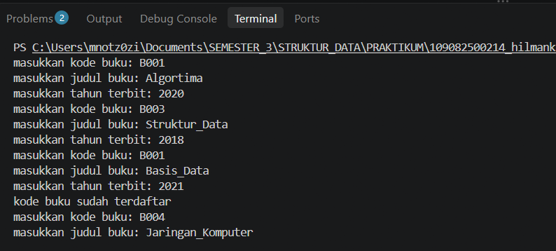
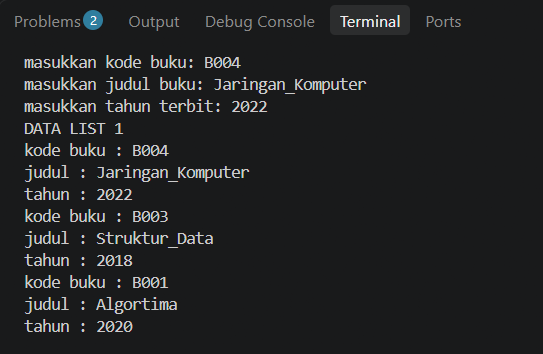
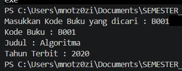
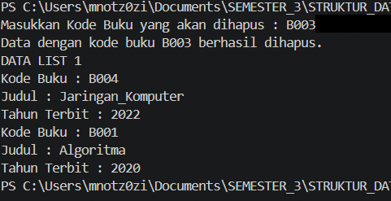

# <h1 align="center">Laporan Praktikum Modul 6 - DOUBLY LINKED LIST (BAGIAN PERTAMA)</h1>
<p align="center">Hilman Kanzi - 109082500214</p>

## Dasar Teori
Struktur data merupakan cara untuk mengatur dan menyimpan data di dalam komputer agar data dapat diakses serta dikelola secara teratur. Salah satu struktur data linear yang digunakan untuk menyimpan kumpulan data adalah linked list atau senarai berantai. Linked list tersusun dari sejumlah elemen yang disebut node. Setiap node menyimpan informasi dan satu atau lebih pointer yang menghubungkannya dengan node lain. Berbeda dengan array yang menempatkan elemen pada lokasi memori berurutan, node pada linked list dapat berada di lokasi memori yang berbeda dan dihubungkan menggunakan pointer [1].

### A. Doubly Linked List<br/>
Doubly Linked List merupakan jenis linked list yang setiap node-nya memiliki dua pointer penghubung, yaitu next dan prev. Pointer next menunjuk ke node setelahnya, sedangkan pointer prev menunjuk ke node sebelumnya. Dengan dua penghubung tersebut, proses penelusuran data dapat dilakukan dari awal ke akhir maupun dari akhir ke awal [1][2].
#### 1. Struktur dan Komponen Doubly Linked List
Komponen utama Doubly Linked List pada praktikum ini adalah sebagai berikut:
Info: bagian node yang menyimpan data. Pada praktikum ini, data buku terdiri dari kodeBuku, judul, dan thnTerbit.
Next: pointer yang menyimpan alamat node berikutnya. Jika node merupakan node terakhir, next bernilai nullptr atau NULL.
Prev: pointer yang menyimpan alamat node sebelumnya. Jika node merupakan node pertama, prev bernilai nullptr atau NULL.
First: pointer pada struktur List yang menunjuk ke node pertama.
Last: pointer pada struktur List yang menunjuk ke node terakhir.
Address: tipe pointer yang digunakan untuk menyimpan alamat suatu node ElmList.
Hubungan antarnode harus dijaga agar konsisten. Jika node A diikuti node B, maka A->next harus menunjuk ke B dan B->prev harus menunjuk kembali ke A. Pada list kosong, First dan Last sama-sama bernilai nullptr. Pada list yang hanya memiliki satu node, First dan Last menunjuk ke node yang sama [1][2].
#### 2. Representasi ADT dalam Bahasa C++
Abstract Data Type (ADT) merupakan cara mendefinisikan tipe data berdasarkan informasi yang disimpan dan operasi yang dapat dilakukan terhadapnya, tanpa mencampurkan seluruh detail implementasi ke dalam program utama. Pada praktikum ini, ADT dipisahkan ke dalam tiga file, yaitu Buku.h, Buku.cpp, dan main.cpp.
- infotype digunakan untuk mendefinisikan data buku, yaitu kode buku bertipe string, judul bertipe string, dan tahun terbit bertipe integer atau int.
- ElmList merupakan node yang memiliki anggota info, next, dan prev.
- List menyimpan pointer First dan Last sebagai penanda awal dan akhir list.
- Buku.h berisi deklarasi struktur data serta prototipe fungsi dan prosedur.
- Buku.cpp berisi implementasi operasi terhadap list.
- main.cpp menjadi program utama untuk menerima input dan menguji operasi ADT.
Pemisahan deklarasi dan implementasi membuat kode lebih terstruktur. Program utama cukup memanggil operasi yang disediakan oleh ADT tanpa perlu menuliskan ulang proses pengaturan pointer pada setiap bagian program [3].
#### 3. Karakteristik, Kelebihan, dan Kekurangan
Doubly Linked List memiliki beberapa karakteristik berikut:
- Ukuran list bersifat dinamis karena node dapat dialokasikan ketika data ditambahkan dan dilepaskan ketika data dihapus.
- Penelusuran dapat dilakukan dua arah melalui next dan prev.
- Pointer First dan Last memudahkan akses ke node pertama dan terakhir.
- Penyisipan atau penghapusan setelah posisi node diketahui dapat dilakukan dengan memperbarui beberapa pointer tanpa harus menggeser seluruh elemen.
- Setiap node membutuhkan ruang tambahan untuk menyimpan dua pointer, sehingga penggunaan memorinya lebih besar dibandingkan Singly Linked List [1][2].
Dengan demikian, Doubly Linked List sesuai digunakan ketika program membutuhkan perpindahan data ke depan dan ke belakang. Namun, setiap operasi insert dan delete harus memperbarui hubungan next dan prev secara benar agar tidak memutus hubungan antarnode.

### B. Operasi Dasar pada Doubly Linked List<br/>
Operasi dasar pada Doubly Linked List meliputi pembuatan list, alokasi node, penambahan data, penelusuran atau pencarian, serta penghapusan data. Setiap operasi harus memperhatikan kondisi list kosong, list berisi satu node, dan list berisi lebih dari satu node [1][3].
#### 1. CreateList, Alokasi, Dealokasi, dan Insert Last
- CreateList(List &L): menginisialisasi list kosong dengan mengatur L.First dan L.Last menjadi nullptr. Langkah ini harus dilakukan sebelum operasi lain dijalankan.
- alokasi(infotype x): membuat node baru menggunakan new, mengisi bagian info dengan data buku x, lalu mengatur next dan prev menjadi nullptr. Fungsi mengembalikan alamat node yang berhasil dibuat.
- dealokasi(address &P): melepaskan memori node yang sudah tidak digunakan menggunakan delete, kemudian mengatur pointer P menjadi nullptr agar tidak menunjuk ke alamat yang sudah dibebaskan.
- insertLast(List &L, address P): menambahkan node baru pada bagian akhir list. Jika list kosong, First dan Last diarahkan ke node baru. Jika list sudah berisi data, P->prev diarahkan ke Last lama, Last->next diarahkan ke P, lalu Last diperbarui menjadi P.
- Pengecekan duplikasi: sebelum node baru dimasukkan, program mencari kodeBuku yang sama. Jika kode sudah ada, data ditolak dan pesan kode buku sudah terdaftar ditampilkan. Jika belum ada, data dialokasikan dan dimasukkan ke akhir list.
#### 2. Searching dan Print Info
findElm(List L, infotype x): mencari node berdasarkan kodeBuku. Pencarian dimulai dari First, kemudian pointer bergerak melalui next sampai kode yang dicari ditemukan atau mencapai nullptr.
Jika kode ditemukan, fungsi mengembalikan alamat node yang sesuai. Jika tidak ditemukan, fungsi mengembalikan nullptr.
printInfo(List L): menampilkan seluruh data buku yang tersimpan di dalam list. Pada contoh keluaran modul, penampilan dilakukan dari Last menuju First dengan mengikuti pointer prev. Karena itu, urutan tampilan merupakan kebalikan dari urutan penambahan data.
Pencarian pada linked list dilakukan dengan memeriksa node satu per satu. Oleh sebab itu, pada kondisi umum waktu pencariannya bertambah seiring jumlah node yang diperiksa [1][2].
#### 3. Delete First, Delete Last, dan Delete After
Operasi delete mengeluarkan node dari rangkaian list. Setelah hubungan pointer diperbarui, node yang dilepas perlu di-dealokasi agar memori tidak terus digunakan.
- deleteFirst(List &L, address &P): menyimpan node pertama ke P. Jika hanya ada satu node, First dan Last diatur menjadi nullptr. Jika terdapat lebih dari satu node, First dipindahkan ke node berikutnya dan prev node pertama yang baru diatur menjadi nullptr.
- deleteLast(List &L, address &P): menyimpan node terakhir ke P. Jika hanya ada satu node, kedua penunjuk list dikosongkan. Jika terdapat lebih dari satu node, Last dipindahkan ke node sebelumnya dan next node terakhir yang baru diatur menjadi nullptr.
- deleteAfter(address Prec, address &P): menghapus node yang tepat berada setelah node Prec. Node yang akan dilepas disimpan ke P, kemudian Prec->next dihubungkan dengan node setelah P. Jika node setelah P tersedia, pointer prev node tersebut juga harus diarahkan kembali ke Prec.
- dealokasi(P): dipanggil setelah node berhasil dilepaskan dari rangkaian list untuk membebaskan memori node tersebut.
Pada praktikum, program mencari terlebih dahulu kode buku yang akan dihapus. Jika node ditemukan, program menentukan apakah node tersebut berada di posisi pertama, terakhir, atau di tengah. Pemilihan prosedur delete harus sesuai dengan posisinya agar First, Last, next, dan prev tetap konsisten [1][3].

## Guided 

### 1. Doublylist.h

```C++
#ifndef DOUBLYLIST_H
#define DOUBLYLIST_H

#include <iostream>
#include <string>

#define Nil NULL

// Latihan 1
struct infotype {
    std::string nopol; 
    std::string warna; 
    int thnBuat;      
};
typedef struct elmlist *address;
struct elmlist {
    infotype info;  
    address next;   
    address prev;   
};
struct List {
    address First; 
    address Last;  
};


// Latihan 1
void CreateList(List &L);
address alokasi(infotype x);
void dealokasi(address &P);
void printInfo(List L);
void insertLast(List &L, address P);

// Latihan 2

address findElm(List L, std::string nopol);

// Latihan 3
void deleteFirst(List &L, address &P);
void deleteLast(List &L, address &P);
void deleteAfter(List &L, address Prec, address &P);
void deleteElm(List &L, std::string nopol, bool &status);

#endif
```
## PENJELASAN GUIDED 1 
program ini Doublylist.h, dibuat deklarasi ADT Doubly Linked List untuk menyimpan data kendaraan. Struktur infotype berisi tiga informasi, yaitu nomor polisi (nopol), warna kendaraan (warna), dan tahun pembuatan (thnBuat). Struktur elmlist berperan sebagai node yang menyimpan data kendaraan pada bagian info serta memiliki pointer next dan prev untuk menghubungkan node sebelum dan sesudahnya. Struktur List memiliki pointer First dan Last sebagai penanda node pertama dan terakhir.
Selain struktur data, file header ini juga berisi deklarasi fungsi dan prosedur yang akan digunakan, seperti CreateList(), alokasi(), dealokasi(), printInfo(), dan insertLast() untuk pengelolaan list. Deklarasi findElm() digunakan pada proses pencarian, sedangkan deleteFirst(), deleteLast(), deleteAfter(), dan deleteElm() digunakan untuk menghapus data berdasarkan posisinya. Dengan adanya file header, struktur dan daftar operasi dapat dikenali oleh file implementasi maupun program utama.
### 2. Doublylist.cpp

```C++
#include "Doublylist.h"

// Latihan 1
void CreateList(List &L) {
    L.First = Nil;
    L.Last = Nil;
}

address alokasi(infotype x) {
    address P = new elmlist;
    P->info = x;
    P->next = Nil;
    P->prev = Nil; 
    return P;
}

void dealokasi(address &P) {
    delete P;
}

void printInfo(List L) {
    address P = L.Last;
    if (P == Nil) {
        std::cout << "List kosong." << std::endl;
        return;
    }
    while (P != Nil) {
        std::cout << "no polisi : " << P->info.nopol << std::endl;   
        std::cout << "warna     : " << P->info.warna << std::endl;   
        std::cout << "tahun     : " << P->info.thnBuat << std::endl; 
        P = P->prev;
    }
}

void insertLast(List &L, address P) {
    if (L.First == Nil) { 
        L.First = P;
        L.Last = P;
    } else {
        P->prev = L.Last;         
        (L.Last)->next = P;     
        L.Last = P;               
    }
}

// Latihan 2
address findElm(List L, std::string nopol) {
    address P = L.First;
    while (P != Nil) {
        if (P->info.nopol == nopol) {
            return P;
        }
        P = P->next;
    }
    return Nil;
}

// Latihan 3
void deleteFirst(List &L, address &P) {
    if (L.First == Nil) return;

    P = L.First; 
    if (L.First == L.Last) { 
        L.First = Nil;
        L.Last = Nil;
    } else {
        L.First = P->next;     
        (L.First)->prev = Nil; 
        P->next = Nil;         
    }
}

void deleteLast(List &L, address &P) {
    if (L.First == Nil) return;

    P = L.Last; 
    if (L.First == L.Last) { 
        L.First = Nil;
        L.Last = Nil;
    } else {
        L.Last = P->prev;      
        (L.Last)->next = Nil; 
        P->prev = Nil;         
    }
}

void deleteAfter(List &L, address Prec, address &P) {
    if (Prec == Nil || Prec->next == Nil) return;

    P = Prec->next;
    if (P == L.Last) {
        deleteLast(L, P);
    } else {
        Prec->next = P->next;     
        (P->next)->prev = Prec; 
        P->next = Nil;            
        P->prev = Nil;           
    }
}

void deleteElm(List &L, std::string nopol, bool &status) {
    address P = findElm(L, nopol);
    status = false;

    if (P != Nil) {
        if (P == L.First) {
            deleteFirst(L, P);
        } else if (P == L.Last) {
            deleteLast(L, P);
        } else {
            address Prec = P->prev;
            deleteAfter(L, Prec, P);
        }
        dealokasi(P); 
        status = true;
    }
}
```
## PENJELSAN GUIDED 2 
file Doublylist.cpp, seluruh operasi yang dideklarasikan di Doublylist.h diisi dengan instruksi yang dapat dijalankan. CreateList() mengatur First dan Last menjadi Nil untuk menandakan list kosong. alokasi() membuat node baru, menyimpan data kendaraan ke bagian info, serta mengatur pointer next dan prev ke Nil. dealokasi() membebaskan memori node yang sudah tidak digunakan.
printInfo() menampilkan data kendaraan dengan memulai penelusuran dari Last dan bergerak ke node sebelumnya melalui prev. insertLast() menambahkan node baru di akhir list. Jika list kosong, node menjadi First sekaligus Last. Jika list sudah memiliki isi, node baru dihubungkan dengan node terakhir lama melalui prev dan next, kemudian pointer Last diperbarui.
Fungsi findElm() mencari data berdasarkan nomor polisi dengan menelusuri list dari First menggunakan next. Jika nomor polisi cocok, fungsi mengembalikan alamat node; jika tidak ada, fungsi mengembalikan Nil. Prosedur deleteFirst(), deleteLast(), dan deleteAfter() melepaskan node sesuai letaknya. Prosedur deleteElm() menentukan posisi node hasil pencarian, memilih prosedur penghapusan yang sesuai, membebaskan node dengan dealokasi(), lalu mengubah status menjadi true jika penghapusan berhasil.
### 3. main.cpp

```C++
#include <iostream>
#include "Doublylist.h"
using namespace std;

void inputData(List &L) {
    infotype data;
    address P;

    cout << "masukkan nomor polisi: "; cin >> data.nopol;
    cout << "masukkan warna kendaraan: "; cin >> data.warna;
    cout << "masukkan tahun kendaraan: "; cin >> data.thnBuat;
    if (findElm(L, data.nopol) == Nil) {
        P = alokasi(data); 
        insertLast(L, P);  
    } else {
        cout << "nomor polisi sudah terdaftar" << endl; 
    }
}

int main() {
    List L;
    CreateList(L); 
    address P;

    inputData(L); 
    inputData(L); 
    inputData(L); 
    inputData(L); 

    cout << "\nDATA LIST 1" << endl; 
    printInfo(L); 

    string nopolCari;
    cout << "\nMasukkan Nomor Polisi yang dicari : "; 
    cin >> nopolCari; 
    
    P = findElm(L, nopolCari); 
    if (P != Nil) {
        cout << "Nomor Polisi : " << P->info.nopol << endl; 
        cout << "Warna        : " << P->info.warna << endl; 
        cout << "Tahun        : " << P->info.thnBuat << endl; 
    } else {
        cout << "Data dengan nomor polisi " << nopolCari << " tidak ditemukan." << endl;
    }

    string nopolHapus;
    bool hapusBerhasil;
    cout << "\nMasukkan Nomor Polisi yang akan dihapus : ";
    cin >> nopolHapus;

    deleteElm(L, nopolHapus, hapusBerhasil); 

    if (hapusBerhasil) {
        cout << "Data dengan nomor polisi " << nopolHapus << " berhasil dihapus." << endl; 
    } else {
        cout << "Data dengan nomor polisi " << nopolHapus << " tidak ditemukan." << endl;
    }
    cout << "\nDATA LIST 1" << endl; 
    printInfo(L); 

    return 0;
}
```
## PENJELASAN GUIDED 3
file main.cpp, program utama digunakan untuk menguji ADT Doubly Linked List dengan data kendaraan. Prosedur inputData() meminta pengguna memasukkan nomor polisi, warna, dan tahun kendaraan. Sebelum data dimasukkan, program memanggil findElm() untuk memeriksa apakah nomor polisi sudah tersimpan. Jika belum ada, data dibuat menjadi node melalui alokasi() dan ditambahkan ke akhir list menggunakan insertLast(). Jika nomor polisi sudah terdaftar, program menampilkan pesan bahwa nomor polisi tersebut telah digunakan.
Setelah empat kali input, program menampilkan isi list dengan printInfo(). Selanjutnya, pengguna diminta memasukkan nomor polisi yang ingin dicari. Hasil pencarian ditampilkan jika node ditemukan, sedangkan pesan tidak ditemukan ditampilkan jika pencarian gagal. Program kemudian meminta nomor polisi yang akan dihapus dan menjalankan deleteElm(). Pesan keberhasilan atau kegagalan penghapusan ditampilkan berdasarkan nilai status. Terakhir, isi list ditampilkan kembali untuk memperlihatkan perubahan setelah penghapusan. Bagian perulangan di akhir program menghapus sisa node satu per satu dan membebaskan memorinya.

## Unguided 

### 1. (Pembuatan ADT Dasar dan Insert Data)
Buat ADT Doubly Linked List untuk menyimpan data buku dengan atribut kodeBuku bertipe string, judul bertipe string, dan thnTerbit bertipe integer. Deklarasikan struktur ElmList yang memiliki bagian info, next, dan prev, serta struktur List yang memiliki pointer First dan Last di dalam file Buku.h.
Implementasikan operasi CreateList(), alokasi(), dealokasi(), printInfo(), dan insertLast() pada file Buku.cpp, kemudian uji melalui program utama. Program harus menerima empat data buku dan memeriksa duplikasi kodeBuku sebelum memasukkan data. Jika kode buku sudah terdaftar, tampilkan pesan kode buku sudah terdaftar dan jangan masukkan data tersebut. Tampilkan isi list dari node terakhir menuju node pertama seperti contoh modul.
### 2. (Pencarian Elemen Searching)
Tambahkan fungsi findElm(List L, infotype x) yang mencari node berdasarkan kodeBuku. Fungsi menelusuri list mulai dari First menggunakan pointer next. Jika kode buku ditemukan, kembalikan alamat node tersebut dan tampilkan kode buku, judul, serta tahun terbitnya. Jika tidak ditemukan, tampilkan pesan bahwa data tidak ditemukan. Uji pencarian menggunakan kode buku B001 sesuai contoh pada modul.
### 3. Penghapusan Elemen (Delete)
Buat prosedur deleteFirst(), deleteLast(), dan deleteAfter() untuk melepaskan node dari Doubly Linked List. Program harus mencari kode buku yang akan dihapus terlebih dahulu. Jika node yang ditemukan berada di awal list, gunakan deleteFirst(); jika berada di akhir list, gunakan deleteLast(); dan jika berada di tengah list, gunakan deleteAfter() dengan node sebelumnya sebagai Prec. Setelah node terlepas dari list, bebaskan memorinya menggunakan dealokasi(). Uji penghapusan dengan kode buku B003 dan tampilkan kembali list setelah penghapusan.

## BUku.h
```C++
#ifndef BUKU_H_INCLUDED
#define BUKU_H_INCLUDED

#include <iostream>
#include <string>
using namespace std;

#define Nil NULL

struct buku {
    string kodeBuku;
    string judul;
    int thnTerbit;
};

typedef buku infotype;
typedef struct ElmList *address;

struct ElmList {
    infotype info;
    address next;
    address prev;
};

struct List {
    address First;
    address Last;
};

// ---------- Soal 1 ----------
void CreateList(List &L);
address alokasi(infotype x);
void dealokasi(address &P);
void printInfo(List L);
void insertLast(List &L, address P);

// ---------- Soal 2 ----------
address findElm(List L, infotype x);

// ---------- Soal 3 ----------
void deleteFirst(List &L, address &P);
void deleteLast(List &L, address &P);
void deleteAfter(address Prec, address &P);

// ---------- Tambahan untuk format tampilan soal 2 dan 3 ----------
void printDetail(address P);
void printInfoDetail(List L);

#endif 
```
## Buku.cpp
```C++
#include "Buku.h"

// ================= SOAL 1 =================

void CreateList(List &L) {
    L.First = Nil;
    L.Last = Nil;
}

address alokasi(infotype x) {
    address P = new ElmList;
    P->info = x;
    P->next = Nil;
    P->prev = Nil;
    return P;
}

void dealokasi(address &P) {
    delete P;
    P = Nil;
}

void printInfo(List L) {
    address P = L.Last;
    while (P != Nil) {
        cout << "kode buku : " << P->info.kodeBuku << endl;
        cout << "judul : " << P->info.judul << endl;
        cout << "tahun : " << P->info.thnTerbit << endl;
        P = P->prev;
    }
}

void insertLast(List &L, address P) {
    P->next = Nil;
    if (L.First == Nil) {          // list kosong
        P->prev = Nil;
        L.First = P;
        L.Last = P;
    } else {
        P->prev = L.Last;
        L.Last->next = P;
        L.Last = P;
    }
}

// ================= SOAL 2 =================

address findElm(List L, infotype x) {
    address P = L.First;
    while (P != Nil) {
        if (P->info.kodeBuku == x.kodeBuku) {
            return P;
        }
        P = P->next;
    }
    return Nil;
}

// ================= SOAL 3 =================

void deleteFirst(List &L, address &P) {
    if (L.First == Nil) {
        P = Nil;
    } else if (L.First == L.Last) {    
        P = L.First;
        L.First = Nil;
        L.Last = Nil;
    } else {
        P = L.First;
        L.First = P->next;
        L.First->prev = Nil;
        P->next = Nil;
    }
}

void deleteLast(List &L, address &P) {
    if (L.First == Nil) {
        P = Nil;
    } else if (L.First == L.Last) {    
        P = L.Last;
        L.First = Nil;
        L.Last = Nil;
    } else {
        P = L.Last;
        L.Last = P->prev;
        L.Last->next = Nil;
        P->prev = Nil;
    }
}

void deleteAfter(address Prec, address &P) {
    if (Prec != Nil && Prec->next != Nil) {
        P = Prec->next;
        Prec->next = P->next;
        if (P->next != Nil) {
            P->next->prev = Prec;
        }
        P->next = Nil;
        P->prev = Nil;
    } else {
        P = Nil;
    }
}

// ================= TAMBAHAN =================

void printDetail(address P) {
    cout << "Kode Buku : " << P->info.kodeBuku << endl;
    cout << "Judul : " << P->info.judul << endl;
    cout << "Tahun Terbit : " << P->info.thnTerbit << endl;
}

void printInfoDetail(List L) {
    address P = L.Last;
    while (P != Nil) {
        printDetail(P);
        P = P->prev;
    }
}
```
## main1.cpp
```C++
#include "Buku.h"

bool bacaBuku(infotype &x) {
    cout << "masukkan kode buku: ";
    if (!(cin >> x.kodeBuku)) return false;
    cout << "masukkan judul buku: ";
    if (!(cin >> x.judul)) return false;
    cout << "masukkan tahun terbit: ";
    if (!(cin >> x.thnTerbit)) {
        if (cin.eof()) return false;
        cin.clear();
        cin.ignore(1000, '\n');
        cout << "tahun terbit harus berupa angka, data tidak disimpan" << endl;
        return false;
    }
    return true;
}

int main() {
    List L;
    CreateList(L);

    for (int i = 0; i < 4; i++) {
        infotype x;
        if (!bacaBuku(x)) {
            if (cin.eof()) break;
            continue;
        }
        if (findElm(L, x) != Nil) {
            cout << "kode buku sudah terdaftar" << endl;
        } else {
            address P = alokasi(x);
            insertLast(L, P);
        }
    }

    cout << "DATA LIST 1" << endl;
    printInfo(L);

    address P;
    while (L.First != Nil) {
        deleteFirst(L, P);
        dealokasi(P);
    }
    return 0;
}
```
### PENJELASAN Buku.h dan Buku.cpp
Pada Buku.h, program mendefinisikan ADT untuk data buku. Struktur buku menyimpan kodeBuku, judul, dan thnTerbit, kemudian digunakan sebagai tipe infotype. Struktur ElmList menjadi node yang menyimpan data buku pada info dan memiliki dua pointer, yaitu next serta prev. Struktur List menyimpan alamat node pertama melalui First dan node terakhir melalui Last. File ini juga mendeklarasikan fungsi dan prosedur untuk proses pembuatan list, alokasi memori, penambahan, pencarian, penghapusan, dan penampilan data.
Pada Buku.cpp, deklarasi tersebut diwujudkan menjadi operasi yang dapat digunakan program utama. CreateList() mengatur list dalam keadaan kosong. alokasi() membuat node dan mengisi seluruh pointer awal dengan Nil, sedangkan dealokasi() menghapus node dari memori dan mengatur kembali pointer-nya menjadi Nil. insertLast() menyambungkan node baru pada bagian akhir dengan memperbarui next, prev, dan Last. printInfo() menampilkan data dari Last ke First melalui pointer prev.
Fungsi findElm() menelusuri list dari First dan membandingkan kodeBuku setiap node dengan kode yang dicari. Prosedur deleteFirst() dan deleteLast() menangani penghapusan di bagian awal dan akhir list, termasuk kondisi ketika hanya ada satu node. Sementara itu, deleteAfter() melepas node setelah Prec dan menyambungkan kembali node sebelum dan sesudahnya. Fungsi tambahan printDetail() menampilkan satu data buku, sedangkan printInfoDetail() menampilkan seluruh data buku dengan format detail.

## main2.cpp
```C++
#include "Buku.h"

int main() {
    List L;
    CreateList(L);

    infotype b1 = {"B001", "Algoritma", 2020};
    infotype b2 = {"B003", "Struktur_Data", 2018};
    infotype b3 = {"B004", "Jaringan_Komputer", 2022};
    insertLast(L, alokasi(b1));
    insertLast(L, alokasi(b2));
    insertLast(L, alokasi(b3));

    infotype cari;
    cout << "Masukkan Kode Buku yang dicari : ";
    cin >> cari.kodeBuku;

    address P = findElm(L, cari);
    if (P != Nil) {
        printDetail(P);
    } else {
        cout << "Kode buku " << cari.kodeBuku << " tidak ditemukan." << endl;
    }

    while (L.First != Nil) {
        deleteFirst(L, P);
        dealokasi(P);
    }
    return 0;
}
```
### PENJELASAN
Program main2.cpp digunakan untuk menguji proses pencarian data buku. Setelah membuat list kosong dengan CreateList(), program menyiapkan tiga data buku, yaitu B001 (Algoritma, 2020), B003 (Struktur_Data, 2018), dan B004 (Jaringan_Komputer, 2022). Ketiga data tersebut dimasukkan ke dalam list menggunakan alokasi() dan insertLast().

Setelah data tersedia, program meminta pengguna memasukkan kode buku yang ingin dicari. Kode tersebut disimpan pada cari.kodeBuku, kemudian dikirim ke fungsi findElm(L, cari). Fungsi akan menelusuri node dari awal list dan membandingkan kode buku pada setiap node. Jika ditemukan, alamat node dikembalikan dan printDetail(P) menampilkan kode buku, judul, serta tahun terbit. Jika tidak ditemukan, program menampilkan pesan bahwa kode buku tersebut tidak tersedia. Sebelum program berakhir, seluruh node dihapus dan memorinya dibebaskan melalui deleteFirst() dan dealokasi().

## main3.cpp
```C++
#include "Buku.h"

int main() {
    List L;
    CreateList(L);

    infotype b1 = {"B001", "Algoritma", 2020};
    infotype b2 = {"B003", "Struktur_Data", 2018};
    infotype b3 = {"B004", "Jaringan_Komputer", 2022};
    insertLast(L, alokasi(b1));
    insertLast(L, alokasi(b2));
    insertLast(L, alokasi(b3));

    infotype hapus;
    cout << "Masukkan Kode Buku yang akan dihapus : ";
    cin >> hapus.kodeBuku;

    address target = findElm(L, hapus);
    address P = Nil;

    if (target == Nil) {
        cout << "Data dengan kode buku " << hapus.kodeBuku << " tidak ditemukan." << endl;
    } else {
        if (target == L.First) {
            deleteFirst(L, P);             
        } else if (target == L.Last) {
            deleteLast(L, P);               
        } else {
            deleteAfter(target->prev, P);   
        }
        dealokasi(P);
        cout << "Data dengan kode buku " << hapus.kodeBuku << " berhasil dihapus." << endl;
    }

    cout << "DATA LIST 1" << endl;
    printInfoDetail(L);

    while (L.First != Nil) {
        deleteFirst(L, P);
        dealokasi(P);
    }
    return 0;
} 
```
### PENJELASAN
Program main3.cpp digunakan untuk menguji proses penghapusan data buku berdasarkan kodeBuku. Program terlebih dahulu membuat list kosong, kemudian memasukkan tiga data awal, yaitu B001, B003, dan B004. Pengguna selanjutnya diminta memasukkan kode buku yang akan dihapus. Fungsi findElm() mencari node dengan kode tersebut dan menyimpan alamatnya pada variabel target.

Jika target bernilai Nil, berarti data tidak ditemukan sehingga program menampilkan pesan kegagalan. Jika data ditemukan, program memeriksa posisi node. Node pertama dihapus menggunakan deleteFirst(), node terakhir menggunakan deleteLast(), sedangkan node di tengah dihapus menggunakan deleteAfter(target->prev, P). Setelah node dilepaskan dari rangkaian list, dealokasi(P) membebaskan memorinya. Program kemudian menampilkan pesan bahwa data berhasil dihapus dan mencetak isi list terbaru melalui printInfoDetail(). Untuk contoh pada modul, penghapusan B003 membuat list hanya menyisakan B004 dan B001. Sisa node dibersihkan sebelum program berakhir.

### Output Unguided 1 :

##### Output soal 1

##### Output ke-2

##### Output soal 2

##### Output soal 3


## Kesimpulan
Berdasarkan praktikum Modul 6 tentang Doubly Linked List, dapat disimpulkan bahwa:
1. Doubly Linked List merupakan struktur data linear yang setiap node-nya memiliki dua pointer, yaitu next untuk menunjuk node berikutnya dan prev untuk menunjuk node sebelumnya. Struktur ini memungkinkan penelusuran data dari dua arah.
2. ADT buku berhasil dirancang dengan memisahkan informasi buku (kodeBuku, judul, dan thnTerbit), node ElmList, serta struktur List yang memiliki penunjuk First dan Last. Pemisahan file header, implementasi, dan program utama membuat susunan program lebih terorganisasi.
3. Operasi insertLast menambahkan node pada bagian akhir list dengan memperbarui hubungan pointer. Pengecekan kodeBuku sebelum penyisipan mencegah data buku dengan kode yang sama dimasukkan lebih dari satu kali.
4. Operasi searching melalui findElm() menelusuri node satu per satu dan membandingkan kode buku sampai data ditemukan atau list selesai diperiksa.
5. Operasi delete dilakukan berdasarkan posisi node. deleteFirst() digunakan untuk node pertama, deleteLast() untuk node terakhir, dan deleteAfter() untuk node setelah posisi tertentu. Setelah node dilepaskan dari list, memori node dibebaskan menggunakan dealokasi().
6. Hasil pengujian sesuai modul menunjukkan bahwa data B001 yang dimasukkan dua kali dapat terdeteksi sebagai duplikasi, pencarian B001 menghasilkan judul Algoritma tahun 2020, dan penghapusan B003 menyisakan data B004 serta B001.

## Referensi
[1] Wijoyo, A., Prayudi, L. A., Fiqih, M., Santoso, R. D., Putra, R. D. S., Arifin, T., & Farhan, A. (2024). “Penggunaan Algoritma Doubly Linked List Untuk Insertion Dan Deletion.” JRIIN: Jurnal Riset Informatika dan Inovasi, 1(12). https://garuda.kemdiktisaintek.go.id/documents/detail/4287537
[2] Valiveti, R. S., & Oommen, B. J. (1993). “Self-Organizing Doubly-Linked Lists.” Journal of Algorithms, 14(1), 88–114. https://doi.org/10.1006/jagm.1993.1005
[3] Morin, P. (2013). Open Data Structures: An Introduction. Athabasca University Press. Bab 3, bagian 3.2: DLList – A Doubly-Linked List. https://opendatastructures.org/ods-java/3_Linked_Lists.html
[4] Feldhausen, R. (2024). “Doubly Linked Lists.” CC 310 Textbook, Kansas State University. https://textbooks.cs.ksu.edu/cc310/04-list/16-doubly-linked-lists/